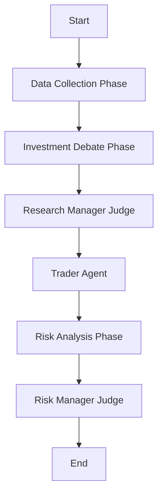

# TradingAgents Codebase Analysis

## Overview

`TradingAgents` is a sophisticated, multi-agent autonomous trading system built using **LangGraph** and **LangChain**. It simulates a professional trading floor where various AI agents—acting as analysts, researchers, traders, and risk managers—collaborate and debate to make informed trading decisions.

The system is designed to:
1.  **Gather Data**: Collect comprehensive market data, news, sentiment, and fundamentals.
2.  **Debate**: Engage in "bull vs. bear" debates to uncover potential upside and downside.
3.  **Plan**: Formulate an investment strategy.
4.  **Risk Assess**: Subject the strategy to a "risk vs. reward" debate among agents with different risk appetites.
5.  **Decide**: Make a final, reasoned Buy/Sell/Hold decision, while learning from past mistakes via a memory system.

## Architecture

The system is architected as a directed cyclic graph (DCG) using `LangGraph`. The workflow proceeds through distinct phases, passing a shared state (`AgentState`) between nodes.

### High-Level Data Flow

### Core Components

#### 1. The Graph (`tradingagents/graph`)
-   **`TradingAgentsGraph`**: The main orchestrator class. It initializes the LLMs, memory systems, and tool nodes, and executes the graph via the `propagate` method.
-   **`GraphSetup`**: Defines the topology of the graph, creating nodes and edges. It handles the wiring of conditional logic (loops) for debates and data gathering.
-   **`ConditionalLogic`**: Determines when to transition between states (e.g., when to stop a debate loop).

#### 2. Agents (`tradingagents/agents`)
The system employs a variety of specialized agents, each with a distinct persona and responsibility:

*   **Analysts** (Data Gatherers):
    *   **Market Analyst**: Fetches technical data (prices, indicators like MACD, RSI).
    *   **Social Media Analyst**: Analyzes sentiment from social platforms.
    *   **News Analyst**: Gathers global and company-specific news.
    *   **Fundamentals Analyst**: Retrieves financial statements (balance sheet, income statement, cash flow).

*   **Researchers** (Debaters):
    *   **Bull Researcher**: Advocating for long positions, focusing on growth and opportunities.
    *   **Bear Researcher**: Advocating for short positions/caution, focusing on risks and weaknesses.

*   **Managers & Judges**:
    *   **Research Manager**: Acts as a judge for the investment debate. It synthesizes the bull/bear arguments to create an initial **Investment Plan**.
    *   **Risk Manager (Risk Judge)**: The final decision maker. It evaluates the risk debate and issues the final **Trade Decision**.

*   **Trader**:
    *   **Trader Agent**: Takes the investment plan and proposes a specific transaction (Buy/Sell/Hold), initiating the risk review.

*   **Risk Analysts** (Risk Debaters):
    *   **Risky Analyst (Aggressive)**: Champions high-risk, high-reward strategies.
    *   **Safe Analyst (Conservative)**: Prioritizes capital preservation and risk avoidance.
    *   **Neutral Analyst**: Balances risk and reward.

#### 3. Data Layer (`tradingagents/dataflows`)
The system abstracts data access through a unified interface, supporting multiple vendors:
-   **Vendors**: `yfinance`, `alpha_vantage`, `google`, `openai`, `local` (simulated).
-   **Tools**:
    *   `core_stock_apis`: OHLCV data.
    *   `technical_indicators`: SMA, EMA, RSI, etc.
    *   `fundamental_data`: Financial statements.
    *   `news_data`: News articles and insider transactions.

#### 4. Memory System (`tradingagents/agents/utils/memory.py`)
The system implements a "Financial Situation Memory" that allows agents to learn from the past.
-   It uses vector search (RAG) to retrieve past decisions made in similar market situations.
-   Memories include the context (market report, sentiment, etc.) and the outcome (recommendation/mistake).
-   Agents are explicitly prompted to "learn from past mistakes" before making new decisions.

## Detailed Workflow

1.  **Initialization**:
    -   `TradingAgentsGraph` is instantiated with a configuration (LLM provider, data vendors).
    -   Memories are loaded.

2.  **Data Collection Phase**:
    -   The graph iterates through selected analysts (Market -> Social -> News -> Fundamentals).
    -   Each analyst has a **Tool Node** to fetch data and an **Analyst Node** to summarize it into a report (e.g., `market_report`, `fundamentals_report`).

3.  **Investment Debate Phase**:
    -   **Bull Researcher** and **Bear Researcher** engage in a loop.
    -   They analyze the reports and debate the merits of the stock.
    -   They reference past memories to strengthen their arguments.

4.  **Strategy Formation**:
    -   **Research Manager** stops the debate, reviews the history, and creates an **Investment Plan**.

5.  **Trading Proposal**:
    -   **Trader** agent converts the plan into a specific action (e.g., "BUY due to strong fundamentals...").

6.  **Risk Analysis Phase**:
    -   The Trader's proposal is debated by **Risky**, **Safe**, and **Neutral** analysts.
    -   They challenge the proposal from their specific risk perspectives.

7.  **Final Decision**:
    -   **Risk Manager** reviews the risk debate.
    -   It makes the **Final Trade Decision** (Buy/Sell/Hold) and logs the rationale.

## Key Files
-   `tradingagents/graph/trading_graph.py`: Main entry point and orchestrator.
-   `tradingagents/graph/setup.py`: Graph definition (nodes/edges).
-   `tradingagents/agents/managers/research_manager.py`: Investment plan creator.
-   `tradingagents/agents/managers/risk_manager.py`: Final decision maker.
-   `tradingagents/dataflows/interface.py`: Data tool definitions.

## Configuration
The system is highly configurable via `default_config.py` or runtime config dictionaries. Key settings include:
-   `llm_provider`: "openai", "anthropic", "google".
-   `data_vendors`: Specific providers for different data types.
-   `max_debate_rounds`: Controls the depth of the debate loops.
