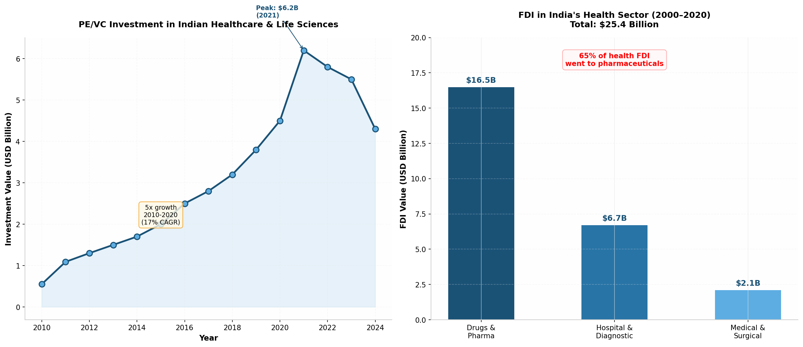
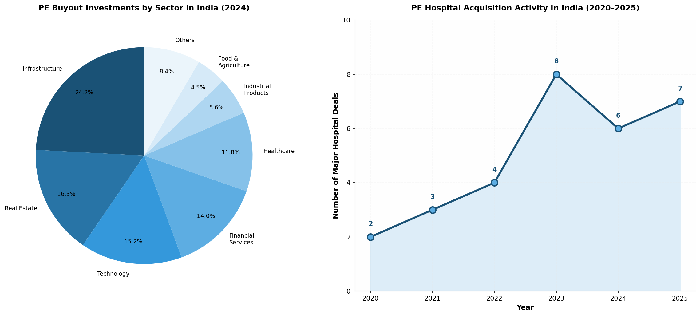

US Private Equity firms have been systematically penetrating India's healthcare, pharmaceutical, and food sectors for **more than two decades**, with the pace of acquisitions accelerating dramatically after 2018. Since the first major US PE hospital investment by **Warburg Pincus in Max Healthcare in 2005**, American private equity firms have deployed **billions of dollars annually** into Indian healthcare assets — from $548 million in 2010 to a peak of **$6.2 billion in 2021** — achieving compounded annual growth of **17%** throughout the 2010–2020 decade [^146^]. By 2025, KKR and Blackstone alone had each committed approximately **$20 billion** to Indian investments across all sectors [^136^][^97^], while India's hospital market reached **$193 billion** with private hospitals controlling **59% of market share** [^151^]. The evidence, drawn from regulatory filings, academic research, corporate disclosures, and investigative reports spanning **2005–2026**, reveals a four-phase takeover pattern: cautious entry (2005–2010), scale and expansion (2010–2015), consolidation through leveraged buyouts (2015–2020), and aggressive acquisition sprees (2020–present). The consequences — rising medical costs now **8x higher** than public facilities, patient abuses documented by Oxfam at PE-backed hospitals, and **54.8% out-of-pocket health expenditure** — raise fundamental questions about whether this foreign capital serves India's public interest or primarily enriches global fund managers [^3^][^49^].

# US Private Equity's Two-Decade Takeover of India's Healthcare, Pharmaceutical, and Food Sectors: A Comprehensive Investigation (2005–2026)

**Report Date:** June 3, 2026

## 1. The Origins: How the Door Opened (1991–2005)

The story of US private equity's penetration into India's essential sectors does not begin in 2020, or even in 2010. It begins in **1991**, when India's government, under pressure from the International Monetary Fund (IMF) and the World Bank, implemented the **Structural Adjustment Programme (SAP)** — a sweeping set of economic reforms that included the liberalisation of foreign investment rules, privatisation of public assets, and reduction of government spending on social services [^130^]. The healthcare sector was one of the most dramatically affected. Between 1991 and 2001, the Indian government's share of total health spending collapsed from **32% to just 20%**, while capital investment in hospitals fell from **25% of the central budget to a meagre 6%** [^130^]. This deliberate hollowing out of public healthcare created the vacuum that private capital — first domestic, then foreign — would rush to fill.

### 1.1 The 1991 Structural Adjustment and Healthcare Privatisation

The SAP's impact on healthcare was not incidental but intentional. The IMF-World Bank policy framework explicitly encouraged developing countries to reduce public health expenditure and rely on private providers to fill the gap [^130^]. In India, this translated into a series of policy measures that made hospital investment increasingly attractive to private capital: healthcare was granted **"industry status"** in the 1980s, opening access to public institutional loans at preferential interest rates; customs duties on medical equipment imports were lowered; and state governments began offering **discounted or free land** to private hospital developers in exchange for commitments to provide free care to poor patients — commitments that were rarely monitored or enforced [^130^]. The 1991 reforms accelerated this trajectory by removing foreign investment restrictions and signalling that India's healthcare future would be privately financed. As one academic analysis noted, *"private investors were expected to compensate for the decrease of public investment in hospital care"* [^130^].

### 1.2 The World Bank's IFC: The Original Foreign Investor in Indian Hospitals

Before any US private equity firm invested in an Indian hospital, the **International Finance Corporation (IFC)** — the private sector arm of the World Bank — had already laid the groundwork. Between **1997 and 2009**, the IFC invested or loaned just under **$225 million** to corporate hospital chains in India, accounting on average for **32% of the total cost** of each project it funded [^130^]. The IFC's investments went to some of India's most prominent hospital groups: **Duncan-Gleneagles** ($7 million in 1997), **Max Healthcare** ($18 million in 2002, then $67 million in 2007, then $30 million in 2009), **Apollo Hospitals** ($20 million in 2005, then $50 million in 2009), **Artemis** ($10 million in 2006), and **Rockland Hospitals** ($22 million in 2008) [^130^]. These IFC investments served a critical function beyond the capital they provided: they validated the Indian hospital sector as an investable asset class for global institutional investors. By putting World Bank money into corporate hospital chains, the IFC effectively **certified** these businesses as creditworthy and developmentally sound, making them attractive targets for subsequent PE investment.

| Hospital Chain | IFC Investment | Year | Share of Project Cost |
|---|---|---|---|
| Duncan-Gleneagles | $7 million | 1997 | 24% [^130^] |
| Max Healthcare | $18 million | 2002 | 21% [^130^] |
| Apollo Hospitals | $20 million | 2005 | 29% [^130^] |
| Artemis Health Institute | $10 million | 2006 | 25% [^130^] |
| Max Healthcare | $67 million | 2007 | 74% [^130^] |
| Rockland Hospitals | $22 million | 2008 | 29% [^130^] |
| Max Healthcare | $30 million | 2009 | 32% [^130^] |
| Apollo Hospitals | $50 million | 2009 | 25% [^130^] |

*Table 1: IFC (World Bank) investments in Indian corporate hospital chains (1997–2009). The IFC's $225 million in cumulative funding helped validate the sector for subsequent private equity investment.*

### 1.3 FII Inflows and the Foreign Institutional Investor Wave (2001–2006)

The early 2000s saw a broader wave of **Foreign Institutional Investor (FII)** capital flowing into Indian hospital stocks, further priming the market for private equity. In **Apollo Hospitals** alone, FII shareholding increased dramatically from **5% in early 2003 to more than 30% by March 2006** [^130^]. Apollo's shareholding pattern from 2001 to 2006 reveals a systematic shift: while promoter holdings remained stable at approximately 30%, the share of Indian public financial institutions (banks, mutual funds) remained minimal, and foreign investors progressively dominated the non-promoter float [^130^]. As noted in an academic analysis from the French Institute of International Relations (IFRI), *"the minor role played by Indian public and Indian financial institutions in the capital of hospital chains in the first half of 2000s"* was striking [^130^]. This pattern — in which foreign capital replaced domestic institutional investment in India's healthcare infrastructure — would become a defining feature of the sector's development.

## 2. Phase 1: Cautious Entry and Testing (2005–2010)

The first direct private equity investments by US firms in Indian healthcare occurred in the mid-2000s, characterised by relatively small ticket sizes, minority stakes, and a cautious approach to a market that was still unproven for financial investors.

### 2.1 Warburg Pincus and Max Healthcare: The Pioneer Deal (2005)

**Warburg Pincus**, then the largest international private equity investor in India with over **$1 billion deployed** in the country [^131^], made the pioneering US PE investment in Indian healthcare in **2005**. The firm invested in two tranches: an initial **₹25 crore** ($5.7 million) at ₹13.25 per share in January 2005, followed by a larger **₹115 crore** ($26 million) at ₹40 per share later in the year [^131^]. Combined with a simultaneous **₹200 crore** ($45 million) investment in Max India (the parent company) for a 28.7% stake, Warburg Pincus's total commitment to the Max Group reached approximately **$77 million** for a 23% stake in Max Healthcare [^131^]. At the time, this was described as a partnership with *"the highest pedigree private equity investor internationally"* [^131^]. Warburg Pincus's investment thesis was straightforward: India's growing middle class, expanding health insurance penetration, and the Max Group's established operational platform in Delhi-NCR created an attractive long-term opportunity. The deal set a template that subsequent PE investors would follow: acquire a significant minority stake in a growing hospital chain, support expansion through follow-on capital, and exit through IPO or secondary sale within a 5–7 year horizon.

### 2.2 The Mid-2000s PE Hospital Investment Wave

Following Warburg Pincus's lead, a wave of PE investments hit India's hospital sector between 2006 and 2009. **IDFC Private Equity** invested **$20 million** in Manipal Hospitals in 2006 [^132^]. **Actis** invested **$16 million** in Sterling Hospitals in 2006 [^132^]. **Samsara Capital** committed **$116 million** to Global Hospitals in 2007 [^132^]. **JP Morgan** invested **$108 million** in Narayana Hrudayalaya in 2008 [^132^]. **I-Ven Medicare** (the PE arm of ICICI, India's largest private equity firm) invested **$24 million** in Vikram Hospitals in 2008 [^132^]. **Goldman Sachs** invested **$115 million** in Max Healthcare in 2009 [^132^]. These investments, while significant in aggregate, were characterised by a common pattern: they were **minority stakes** in existing hospital chains, typically between $10 million and $120 million in value, reflecting the limited scale of India's corporate hospital sector at the time and the cautious approach of first-mover PE investors.

| Year | PE Firm | Target | Investment | Stake |
|---|---|---|---|---|
| 2005 | Warburg Pincus | Max Healthcare | ~$34M | 23% [^131^] |
| 2006 | IDFC PE | Manipal Hospitals | $20M | Minority [^132^] |
| 2007 | Apax Partners | Apollo Hospitals | $100M | 11% [^160^] |
| 2007 | Samsara Capital | Global Hospitals | $116M | Minority [^132^] |
| 2008 | JP Morgan | Narayana Hrudayalaya | $108M | Minority [^132^] |
| 2008 | I-Ven Medicare | Vikram Hospitals | $24M | Minority [^132^] |
| 2009 | Goldman Sachs | Max Healthcare | $115M | Minority [^132^] |

*Table 2: Major US and global PE investments in Indian hospitals during Phase 1 (2005–2009). All were minority stakes, reflecting cautious first-mover strategies.*

### 2.3 Apax Partners and Apollo: The First Blockbuster (2007)

The deal that signalled PE's serious intent in Indian healthcare was **Apax Partners' $100 million investment in Apollo Hospitals** in September 2007 [^160^]. Apax, a British-US private equity firm, acquired an **11% stake** at ₹605.07 per share, with the stated purpose of funding Apollo's expansion across five Indian cities including Mumbai, Chennai, and Hyderabad [^160^]. The investment was notable for its size — at $100 million, it was among the largest PE investments in Indian healthcare at the time — and for Apax's reputation as a sophisticated healthcare investor with prior experience owning General Healthcare Group (the UK's largest private hospital operator) [^160^]. Apax subsequently increased its stake to **19%** through market purchases in 2008, making it Apollo's second-largest shareholder after the Reddy family promoters [^156^]. The investment would prove extraordinarily profitable: when Apax began exiting in 2013, it sold its stake in multiple tranches for a total of approximately **₹2,240 crore ($420 million)**, representing a **3.3x return** on its initial investment [^156^].

## 3. Phase 2: Scale, Expansion, and the First Exits (2010–2015)

The period from 2010 to 2015 marked a maturation of PE investment in Indian healthcare. Deal sizes increased, investment themes diversified beyond large tertiary care chains to include single-specialty hospitals and diagnostics, and the first significant exits demonstrated that Indian healthcare could generate the returns that PE firms required.

### 3.1 KKR Enters India Healthcare Through Radiant Life Care (2010)

**KKR's** entry into Indian healthcare began not with a hospital acquisition but with an investment in a hospital management company. In **2010**, KKR acquired a **49% stake in Radiant Life Care** for approximately **$200 million** (₹1,288 crore) [^164^]. Radiant, founded by restructuring specialist Abhay Soi in 2010, operated two iconic facilities: **BLK Super Specialty Hospital** in Delhi and **Nanavati Super Specialty Hospital** in Mumbai [^162^]. KKR's investment thesis was that Radiant's asset-light management contract model — in which it took over operations of underperforming hospitals and restructured them for profitability — could be scaled across India. This would prove to be one of KKR's most consequential Indian investments, as Radiant would later serve as the platform for KKR's acquisition of Max Healthcare.

### 3.2 Advent International's First India Healthcare Bet: CARE Hospitals (2012)

**Advent International**, the Boston-based PE firm that would later become one of the most active healthcare investors in India, made its first healthcare investment in the country in **2012**, committing approximately **$110 million** to **CARE Hospitals** [^132^]. At the time, CARE was a regional hospital chain with a strong presence in South India. Advent's investment helped the chain expand its network and upgrade facilities. This early investment would set the stage for Advent's subsequent, much larger healthcare bets in India, including the transformative acquisition and exit of Bharat Serums and Vaccines. Notably, Advent had made its very first investment in India in **2007** — not in healthcare but in **CAMS** (Computer Age Management Services), a financial services company [^174^] — demonstrating the firm's long-term commitment to the Indian market before turning its attention to healthcare.

### 3.3 The Apax Exit from Apollo: Proof of Concept (2013)

The most significant development of this phase was not a new investment but an exit. In **2013**, Apax Partners began selling its stake in Apollo Hospitals, completing one of the most successful PE exits in Indian healthcare history. Apax sold **19% of Apollo** in multiple open market transactions for approximately **₹2,240 crore ($420 million)**, having initially invested just **$100 million** in 2007 [^156^]. The **3.3x return** in rupee terms was achieved as Apollo's share price increased 3.5 times over the investment period, while the Indian stock market climbed only 1.5 times — meaning, as Apax's India MD Shashank Singh noted, *"most of our return on Apollo has been alpha"* [^156^]. The exit was significant beyond its financial returns: it proved to the global PE community that Indian hospital investments could generate the kind of returns that justified the risk and capital commitment. As one analyst noted at the time, Apollo was *"among the best performing PE investments of $100 million and above in 2007"* — a watershed year that saw 47 such deals in India, of which only two returned three-fold profits [^156^].

### 3.4 KKR's Apollo Investment and the Deepening Relationship (2013)

Following Apax's exit, **KKR invested approximately $89.5 million** (INR 5.5 billion) in Apollo Hospitals in **October 2013** [^139^][^140^]. This investment deepened KKR's relationship with India's largest hospital chain and complemented its existing Radiant Life Care investment. KKR's investment came at a time when Apollo was expanding aggressively, adding 1,340 beds across five cities and building hospitals in Mumbai, Chennai, and Hyderabad [^160^]. The investment demonstrated KKR's conviction that India's hospital sector offered multiple entry points — through management companies (Radiant), large chains (Apollo), and specialty platforms.

### 3.5 TPG Capital and Manipal: Building a National Platform (2015)

In **February 2015**, **TPG Capital** took a **22% stake in Manipal Health Enterprises** for **₹900 crore** (approximately **$140 million**), alongside Premji Invest and IDFC Private Equity [^142^][^104^]. By this point, Manipal had grown from a single loss-making hospital in Bangalore to a network of 15 hospitals with roughly **$1 billion in cumulative backing** from Kotak, True North, Faering Capital, TPG, Premji Invest, and IDFC [^104^]. TPG's investment thesis was direct: *"India's middle class was growing, insurance coverage was expanding, and the disease burden was not going anywhere. Private hospitals were not a luxury business. They were infrastructure"* [^104^]. TPG's entry into Manipal was significant because it represented a shift from minority financial investments to strategic partnership with a platform that would later become India's second-largest hospital chain. TPG's 22% stake, combined with the investments of other PE backers, meant that **foreign institutional capital controlled a significant portion of Manipal's equity** — a pattern that would become increasingly common in India's corporate hospital sector.

## 4. Phase 3: Consolidation Through Leveraged Buyouts (2015–2020)

The period from 2015 to 2020 marked a qualitative shift in PE's approach to Indian healthcare. Deal structures became more complex, involving leveraged buyouts, merger-and-acquisition platforms, and multi-layered ownership structures. PE firms moved from passive minority investors to active owners seeking **controlling stakes**.

### 4.1 KKR's Max Healthcare Takeover: The Template for PE Control (2018–2019)

The most consequential transaction of this phase — and arguably the defining deal of US PE's Indian healthcare strategy — was **KKR's acquisition of Max Healthcare** between 2018 and 2019. The transaction was extraordinarily complex, involving multiple steps, entities, and regulatory approvals over nearly 18 months [^163^][^141^].

In **2017**, KKR had acquired a **49% stake in Radiant Life Care** for **$200 million** [^164^]. In **September 2018**, KKR used Radiant as the acquisition vehicle to purchase **Life Healthcare's 49.7% stake in Max Healthcare** for **$293 million** (4.3 billion rand) [^164^]. This was followed by a complex demerger and reverse merger: Max India spun off its non-healthcare businesses (Max Bupa Health Insurance and Antara Senior Living) into a separate listed entity; Radiant's healthcare assets were demerged into Max Healthcare; and Max Healthcare undertook a reverse merger with Max India, resulting in Max India's dissolution and the listing of the merged entity [^165^][^163^]. KKR also acquired an additional **4.99% stake** from Max promoters for approximately **$52.2 million** (INR 361 crore) [^162^].

The resulting ownership structure was striking: **KKR held 51.9%**, Abhay Soi (Radiant's promoter) held **23.2%**, and Max India's original promoters held just **7%** [^163^]. The merged entity was valued at **₹7,242 crore (~$1 billion)** and operated over **3,200 beds across 16 hospitals** [^165^]. KKR's total investment across the various tranches exceeded **$545 million** — making it one of the largest PE commitments to a single Indian healthcare asset at the time.

The speed and scale of KKR's value extraction was equally remarkable. Just **three months after completing the merger**, in 2020, Max Healthcare was listed on India's stock exchanges, triggering a jump in share value [^141^]. KKR began selling its stake almost immediately, reducing its holding from 47.24% in mid-2021 to 27.54% by mid-2022 [^147^][^159^]. In **August 2022**, KKR sold its entire remaining stake via bulk deals at **₹353 per share** — having originally acquired shares at **₹80 per share** [^161^]. The total exit value was approximately **₹9,400 crore ($1.2 billion)**, generating an estimated **4.4x return** in roughly **four years** [^141^][^147^]. The transaction was described as *"the largest single block deal by a private equity firm in India"* and *"the first instance of over 25% sell-down by a PE firm"* [^161^].

The financial engineering was breathtaking in its sophistication and profitability. But the transaction also demonstrated the **PE ownership model's fundamental misalignment** with healthcare as a public good. KKR had acquired India's third-largest hospital chain, restructured its ownership to maximise financial returns, listed it on stock exchanges within months, and exited completely within four years — pocketing hundreds of millions in profits while patients, employees, and communities were left with a hospital system optimised for shareholder returns rather than public health outcomes.

### 4.2 TPG, Abraaj, and the Evercare Fund: DFI-Backed Healthcare (2019)

In **2019**, TPG Capital acquired the **Evercare Health Fund** from the collapsed **Abraaj Group**, a Dubai-based private equity firm that had been one of the largest investors in emerging market healthcare [^5^][^22^]. The Evercare Fund, with approximately **$1 billion in commitments**, was focused on building hospital and care delivery platforms in Africa and South Asia [^22^]. Its Indian asset was **CARE Hospitals**, which Advent International had originally invested in back in 2012. TPG's acquisition of Evercare — and thus CARE Hospitals — represented a new model of PE healthcare investment in India: one backed by **Development Finance Institutions (DFIs)** including the **U.S. International Development Finance Corporation (DFC)**, the **World Bank's International Finance Corporation (IFC)**, **British International Investment**, and **Proparco** (France), alongside the Bill & Melinda Gates Foundation, Philips, and Medtronic [^23^][^52^]. This structure — in which US and European taxpayer-backed development funds channelled capital into a PE-owned hospital platform — would later attract intense criticism from civil society organisations.

### 4.3 The Fortis Saga: International Bidding War (2018)

While not a US PE transaction, the **Fortis Healthcare acquisition battle** of 2018 illustrated the intensity of foreign interest in India's hospital assets. Fortis, founded by the Singh brothers (promoters of Ranbaxy Pharmaceuticals), faced a governance crisis involving allegations of fund diversion and a legal battle with Japanese drugmaker **Daiichi Sankyo** [^173^]. Multiple bidders — including **IHH Healthcare** (Malaysian, backed by Japan's Mitsui), **Manipal-TPG**, and a Hero-Burman consortium — competed for control [^175^]. Ultimately, **IHH Healthcare** acquired a **31.1% controlling stake** for approximately **$618 million** (INR 4,000 crore) [^173^][^175^]. The transaction was followed by years of litigation, with IHH seeking up to **$1.7 billion** in compensation from Daiichi Sankyo for allegedly preventing IHH from completing mandatory open offers to acquire additional shares [^175^][^177^]. The Fortis saga demonstrated that India's hospital assets had become valuable enough to trigger **international bidding wars, multi-billion-dollar litigation, and geopolitical entanglements**.

## 5. Phase 4: The Aggressive Takeover (2020–2026)

The period from 2020 to 2026 represents the most aggressive phase of US PE penetration into Indian healthcare, with deal sizes, ownership stakes, and sectoral breadth all reaching unprecedented levels. Firms like Blackstone, KKR, Carlyle, Advent, and TPG executed transactions that collectively transferred control of hospital chains, pharmaceutical companies, and food brands worth tens of billions of dollars to US-based investors.

### 5.1 Blackstone's Billion-Dollar Hospital Platform (2023–2025)

Blackstone's entry into Indian healthcare in 2023 was not its first investment in the country — the firm had been active in India since 2006, with investments including Mphasis ($1.6 billion tech acquisition in 2016) [^136^][^134^] — but it was by far its largest and most consequential healthcare play. In **October 2023**, Blackstone announced two simultaneous transactions that created one of India's largest hospital platforms: the acquisition of **73% of CARE Hospitals** from TPG's Evercare platform for approximately **$800 million** (₹6,640 crore), and the acquisition of an **80% stake in KIMS Health** for approximately **$300 million** (₹2,490 crore) [^26^][^7^]. The combined platform of CARE and KIMS created a network of **23 hospitals and 4,000 beds across 16 cities** [^7^]. Blackstone's total commitment exceeded **$1 billion**, making it one of the largest single-firm investments in Indian healthcare history [^26^]. Since the acquisition, Blackstone has pursued an aggressive expansion strategy, reportedly bidding for **Sahyadri Hospitals** (valued at ~$800 million), **Medica Synergie**, and other regional chains [^18^]. The firm's stated objective is to build a pan-India hospital platform capable of competing with Apollo, Max, and Fortis.

### 5.2 KKR's Multi-Billion-Dollar Healthcare Portfolio (2020–2025)

Following its exit from Max Healthcare in 2022, KKR did not retreat from Indian healthcare — it **doubled down**. The firm constructed the most diversified healthcare portfolio of any US PE firm in India, spanning hospitals, pharmaceuticals, medical devices, and health technology [^41^]. In **2020**, KKR acquired **JB Chemicals and Pharmaceuticals**, which it would later sell to Torrent Pharmaceuticals in **2025** for **$3.1 billion** — one of the largest pharma exits in Indian PE history [^24^]. In **2024**, KKR acquired controlling stakes in **Healthium Medtech** ($840 million), **Baby Memorial Hospital** ($280–300 million), and **Infinx Services** ($150 million) [^119^][^113^][^121^]. In **2025**, it acquired **Healthcare Global (HCG)**, India's largest cancer hospital chain, for approximately **$400 million** [^40^]. Across these transactions, KKR deployed well over **$5 billion** in Indian healthcare assets between 2020 and 2025, with exits generating multiple billions more.

### 5.3 Advent International: Record Returns and Pharma Dominance

Advent International has emerged as one of the most successful US PE firms in Indian healthcare, generating **record returns** from pharmaceutical investments. The firm's transformation of **Bharat Serums and Vaccines** — acquired for approximately **$500 million** in 2019 and sold to Mankind Pharma for **$1.63 billion** in 2024 — generated a **3x return** and was the largest strategic exit of 2024 [^56^][^58^]. Advent's $490 million investment in **Piramal Pharma** (2020), $297 million in **Apollo HealthCo** (2024), and its consolidation of **Cohance Lifesciences** through multiple pharma services mergers demonstrate a clear strategy of building and exiting pharmaceutical platforms [^32^][^48^][^62^]. In **2024 alone**, Advent returned a record **$3 billion** to its limited partners from Indian exits — a figure that underscores the extraordinary profitability of PE's Indian healthcare strategy [^57^].

### 5.4 The Food Sector Invasion: Haldiram's and Beyond

US and global PE penetration into India's food sector reached new heights in 2024–2025. **Haldiram's Snacks Food**, India's largest ethnic snacks brand, attracted a bidding war that valued the company at approximately **$10 billion** [^81^][^84^]. **Temasek** (Singapore) acquired ~10% for **$1 billion**, **Alpha Wave Global** (UAE) acquired 6% for ₹5,600 crore, and **L Catterton** (the LVMH-backed US consumer PE firm managing $39 billion) acquired a strategic minority stake [^81^][^74^][^78^]. In 2024, **Capital Foods** (maker of Ching's Secret) was sold to Tata Consumer Products for **$460 million** in an exit by Invus Group and General Atlantic [^48^]. **Advanta Seeds** received **$350 million** from Alpha Wave Global [^48^]. These transactions signal that PE interest has penetrated beyond healthcare into India's dietary staples and agricultural inputs.

*Figure 1: Comprehensive timeline of major US private equity investments in Indian healthcare from 2005 to 2026. The timeline reveals four distinct phases of increasing aggression and scale. Data compiled from public filings, press releases, and financial databases.*

## 6. By the Numbers: The Scale of Foreign Control

The cumulative data on PE investment, FDI inflows, hospital market share, and ownership patterns paints a clear picture of the extent to which US and global private equity firms have penetrated India's healthcare and food sectors.

### 6.1 Cumulative PE/VC Investment Growth

PE/VC investments in India's healthcare and life sciences sector grew at a **17% CAGR during 2010–2020**, with the investment value rising **5x from $548 million in 2010 to $2.5 billion in 2020** [^146^]. By 2021, investment peaked at approximately **$6.2 billion**, driven by COVID-19-related healthcare investments and the Reliance Jio platform effect [^146^]. In 2023, PE investments in Indian healthcare and pharma reached **$5.5 billion**, a 25% increase from the previous year [^3^]. The broader PE/VC market in India saw **$56 billion in investments across 1,352 deals in 2024**, with the life sciences sector receiving **$4.3 billion** [^166^]. Between 2021 and 2024, healthcare accounted for **17–18% of total PE exits in India** [^3^].

*Figure 2: Left — The growth trajectory of PE/VC investment in Indian healthcare and life sciences, showing a 5x increase from 2010 to 2020 and a peak of $6.2 billion in 2021. Right — FDI in India's health sector (2000–2020), with 65% concentrated in pharmaceuticals. Data sources: CAIA/Venture Intelligence, NITI Aayog [^146^][^108^].*

### 6.2 FDI Inflows: The Structural Dependency

India's health sector received **$25.357 billion in FDI between 2000 and 2020**, according to NITI Aayog data [^108^]. The distribution was heavily skewed toward pharmaceuticals: **$16.501 billion (65%)** went to drugs and pharmaceuticals, **$6.727 billion (26.5%)** to hospital and diagnostic centres, and **$2.130 billion (8.4%)** to medical and surgical appliances [^108^]. Between April 2000 and June 2020 alone, India received **$6.8 billion in FDI specifically in hospitals and diagnostic centres** [^108^]. These figures understate the true extent of foreign ownership because they do not capture investments routed through Mauritius, Singapore, and Cayman Islands structures that obscure ultimate beneficial ownership.

| Metric | Value | Source Period |
|---|---|---|
| Total PE/VC investment in India (2024) | $56.0 billion | 2024 [^166^] |
| PE/VC in India healthcare/life sciences (2024) | $4.3 billion | 2024 [^166^] |
| Healthcare/life sciences PE/VC (2023) | $5.5 billion | 2023 [^3^] |
| Healthcare/life sciences PE growth (2010–2020) | 17% CAGR | 2010–2020 [^146^] |
| 5x growth in healthcare PE ($548M → $2.5B) | 5x | 2010–2020 [^146^] |
| Total FDI in India's health sector | $25.357 billion | 2000–2020 [^108^] |
| FDI in drugs & pharmaceuticals | $16.501 billion | 2000–2020 [^108^] |
| FDI in hospitals & diagnostic centres | $6.727 billion | 2000–2020 [^108^] |
| FDI in hospitals/diagnostic (Apr 2000–Jun 2020) | $6.8 billion | 2000–2020 [^108^] |
| India hospital market size | $193.42 billion | 2025 [^151^] |
| Private hospital market share | 59% | 2025 [^151^] |
| Private hospitals in India | 44,100 | 2024 [^3^] |
| Private hospital beds | ~1.18 million | 2024 [^3^] |
| Private infrastructure share of health | 62% | 2020 [^148^] |
| Hospital bed density (India) | 1.3 per 1,000 | 2024 [^3^] |
| Hospital bed density (OECD average) | 4.3 per 1,000 | 2024 [^3^] |
| India's out-of-pocket health expenditure | 54.8% | 2024 [^3^] |
| Households pushed below poverty line by health costs | 8–9% | 2023 [^3^] |
| ARPOB range (major chains) | ₹38,000–74,000+ | 2024 [^103^] |
| KKR India total investment | ~$20 billion | Cumulative [^41^] |
| Blackstone India total investment | ~$20 billion | Cumulative [^97^] |
| Advent International India commitment | $6+ billion | Cumulative [^57^] |
| IVCA member funds total AUM | $350+ billion | 2024 [^172^] |

*Table 3: Key quantitative indicators of PE penetration and healthcare market structure in India. The data reveals a healthcare system increasingly dependent on private capital, with foreign PE firms controlling major assets.*

### 6.3 Hospital Market Share: Who Owns What

India's hospital market is projected to reach **$364.55 billion by 2034**, growing at a **7.3% CAGR** from $193.42 billion in 2025 [^151^]. Private hospitals dominate with **59% market share**, compared to 28% for public hospitals and 13% for public-private partnerships [^151^]. Within the private sector, corporate hospital chains — the primary targets of PE investment — represent approximately **15–20% of private hospital revenues** [^151^]. While this percentage may seem modest, the corporate chains control the most profitable, high-ARPOB tertiary and quaternary care facilities in major cities. The ARPOB (Average Revenue Per Occupied Bed) for major PE-backed chains ranges from **₹38,000 to over ₹74,000 per bed per day** [^103^], compared to public hospital rates that are a fraction of these amounts.

The major hospital chains and their PE ownership structures reveal the extent of foreign control. **Apollo Hospitals** remains promoter-controlled (Reddy family) but has had significant FII/PE holdings including Apax Partners (fully exited), Khazanah Nasional (Malaysia's sovereign wealth fund, ~11%), and KKR (exited). **Max Healthcare** was majority-owned by KKR (fully exited 2022); now promoter-controlled by Abhay Soi (23%) with GIC (Singapore) as the largest institutional shareholder (8.7%) [^141^]. **Fortis Healthcare** is controlled by **IHH Healthcare** (Malaysia/Mitsui, 31.1%) [^173^]. **Manipal Hospitals** has TPG, Temasek, Mubadala, and Novo Holdings as significant investors and is preparing a $1 billion+ IPO [^104^]. **CARE Hospitals + KIMS** is controlled by **Blackstone** (73%) with TPG retaining 25% [^26^]. **HCG** is being acquired by **KKR** (54–77%) [^40^]. **Baby Memorial Hospital** is controlled by **KKR** (65%) [^113^]. **Sahyadri Hospitals** was sold to Manipal (Temasek-backed) in 2025 after being owned by Ontario Teachers' Pension Plan [^105^].

| Hospital Chain | Primary Foreign Owner(s) | Beds | Hospitals | Control Level |
|---|---|---|---|---|
| Apollo Hospitals | Promoter (Reddy family), Khazanah | ~7,000+ | 40+ | Promoter-controlled |
| Max Healthcare | Abhay Soi (23%), GIC (8.7%) | 5,000 | 22 | Promoter-controlled [^141^] |
| Fortis Healthcare | IHH Healthcare/Mitsui (31.1%) | 4,500+ | 28 | Foreign-controlled [^173^] |
| Manipal Hospitals | TPG, Temasek, Mubadala, Novo | ~12,000 | 49 | PE/Foreign-backed [^104^] |
| CARE + KIMS | Blackstone (73%), TPG (25%) | ~4,000 | 23 | PE-controlled [^26^] |
| HCG | KKR (54–77%) | 2,500 | 25 | PE-controlled [^40^] |
| Baby Memorial | KKR (65%) | 1,000 | 2+ | PE-controlled [^113^] |
| Narayana Hrudayalaya | Publicly listed | ~6,000 | 20+ | Independent |

*Table 4: Ownership structure of major Indian hospital chains. PE-backed or foreign-controlled chains account for a significant and growing share of India's organized hospital capacity.*

### 6.4 The Profitability Engine: Returns That Attract Capital

The extraordinary returns generated by PE investments in Indian healthcare explain why capital continues to flow into the sector. **Advent International** returned a record **$3 billion** to LPs from India in 2024, with returns of **3x** on Bharat Serums and comparable multiples across other exits [^57^]. **KKR** generated approximately **5x returns** on its Max Healthcare exit and **multiple billions** from its JB Pharma exit [^113^][^24^]. **Apax Partners** achieved a **3.3x return** on its Apollo Hospitals investment over six years [^156^]. **Blackstone** has stated that its India investments have yielded *"some of the highest returns"* globally [^57^]. These returns are generated through a combination of operational improvements (margin expansion, cost optimisation), financial engineering (leverage, dividend recapitalisation), and multiple expansion (listing on public markets at premium valuations). Hospital multiples in India reach **28x Enterprise Value/EBITDA**, with high-ARPOB facilities commanding up to **35x** — multiples that are among the highest globally for healthcare assets [^103^].

## 7. The Consequences: Evidence of Harm

The evidence of adverse consequences from PE ownership of Indian healthcare assets is extensive, spanning academic research, investigative journalism, patient advocacy reports, and regulatory complaints. These harms are not incidental but structural outcomes of the PE business model, which operates on **3–7 year investment horizons** that incentivise aggressive cost-cutting, revenue maximisation, and rapid exit over long-term patient welfare [^17^].

### 7.1 The Cost Explosion: Evidence from National Data

The most direct and measurable impact of PE-driven hospital consolidation has been the **dramatic widening of the cost gap** between private and public healthcare facilities. According to National Sample Survey data analysed by the University of Pennsylvania's Center for the Advanced Study of India (CASI), hospitalisation in private hospitals cost **2.3 times more than public hospitals in rural areas and 3.1 times more in urban areas** in 1986–87 [^3^]. By 2017–18, these gaps had widened to **6.4 times in rural areas and 8.0 times in urban areas** [^3^]. This cost explosion occurred concurrently with the expansion of corporate hospital chains and PE investment, though the causal relationship is complex and involves multiple factors including medical technology advancement, specialist doctor salaries, and real estate costs. However, the correlation is striking, and the direction of causation — in which PE ownership drives ARPOB maximisation — is supported by investor presentations from PE-backed hospital chains that explicitly cite ARPOB growth as a key performance metric.

### 7.2 Oxfam's "Sick Development": Documented Patient Abuses

Oxfam International's **"Sick Development"** report, published in June 2023, provided the most damning evidence of patient harm at PE-backed hospitals in developing countries, with extensive documentation from India [^49^]. The report investigated how Development Finance Institutions (DFIs) — including the World Bank's IFC, the **U.S. DFC**, and European DFIs — channel taxpayer money into PE-owned hospital chains that engage in practices directly contrary to the Sustainable Development Goal of universal health coverage [^49^]. In India, Oxfam investigators found cases of **emergency patients being denied treatment** — including a child badly injured in a traffic accident, a stab victim, and a woman crushed when bulldozers demolished her informal settlement [^49^]. Patients reported being **blocked from using government health insurance cards** (entitling them to free care under schemes like Ayushman Bharat) and instead being charged fees that pushed families into debt [^49^]. A woman from an informal settlement in Odisha described a DFI-funded corporate hospital in stark terms: *"When they learn that we are from the slum the hospital staff make us leave…we don't take people there now… It is not for us. It is not for the poor families. It is for the rich people"* [^49^].

### 7.3 Counter Currents Investigation: Rising Malpractice Allegations

An investigative report published in Counter Currents in May 2026 documented **"rising allegations of malpractices at the so-called large hospital chains"** under PE ownership [^18^]. The report cited patient and consumer forum complaints about **price-related issues, unwanted diagnostic tests, inflated bills, and efforts by hospital authorities to ensure prolonged stays** that result in larger bills [^18^]. The investigation noted that *"hospitals working under the pressure of private equity investors have removed the thin line between quality care and commercial exploitation resulting in financial devastation for patients"* [^18^]. These allegations align with academic research from the United States, where a systematic review of 47 studies found that PE ownership of healthcare facilities was *"largely associated with lower performance on health system aims including patient health outcomes, process quality, and costs for patients and other payers"* [^115^].

### 7.4 The UPenn CASI Study: Equity versus Access

Research from the **University of Pennsylvania's Center for the Advanced Study of India (CASI)** provides the most comprehensive academic analysis of PE's impact on Indian healthcare. The study documents that while PE investments have expanded physical infrastructure — with **22,000 new hospital beds** expected to be added in private hospitals over the next 3–5 years, tripling the number added between 2019 and 2024 — this expansion has been **concentrated in high-margin services and urban areas** [^3^]. PE-backed hospital chains like Manipal, Fortis, and Care have expanded primarily in Tier 2 and Tier 3 cities, but the services offered focus on tertiary care, specialised surgeries, and diagnostic procedures that generate the highest returns — rather than primary care, preventive services, or rural health access [^3^]. India's **out-of-pocket health expenditure constituted approximately 54.8% of current health expenditure in 2024** — one of the highest rates globally — and healthcare expenses pushed **8–9% of all Indian households below the poverty line** in 2023 [^3^]. The CASI study concludes that *"PE investments typically focus on high-return markets, prioritizing urban and affluent populations while neglecting rural and marginalized communities"* [^3^].

### 7.5 Academic Consensus: Financialisation and Systemic Distortion

A landmark academic paper published in PMC, **"Financialisation and the Reshaping of Private Healthcare,"** examined how financialisation has transformed India's private healthcare system [^127^]. The study found that PE investment has encouraged the growth of **corporate forms of healthcare that distort or crowd out other forms of provision**, reshaping care processes, professional dynamics, access to services, and regulatory systems [^127^]. The paper highlighted the *"trickle-down"* of financialisation from global capital markets to Indian healthcare delivery, demonstrating how financial motives and values increasingly dominate clinical decision-making [^127^]. A separate systematic review of PE ownership in US healthcare found consistent evidence of **increased charges, higher negotiated prices, reduced staffing ratios, and mixed effects on quality** — patterns that appear to be replicating in the Indian context [^11^][^115^].

## 8. The Food Sector: A Parallel Invasion

While healthcare has attracted the most PE capital and the most scrutiny, India's food processing sector — valued at approximately **$535 billion** and growing at **8.3% annually** [^112^] — has emerged as a major destination for private equity investment, raising parallel concerns about foreign control over dietary staples and agricultural supply chains.

### 8.1 Haldiram's: The $10 Billion Snack Empire

The most prominent example of PE penetration into India's food sector is **Haldiram's Snacks Food Private Limited**, which achieved a valuation of approximately **$10 billion** (₹89,000 crore) in 2025 following a bidding war among global investors [^81^][^84^]. **Temasek** acquired approximately **10% for $1 billion** [^81^][^86^], **Alpha Wave Global** acquired **6% for ₹5,600 crore** [^78^], and **L Catterton** — the LVMH-backed US consumer-focused PE firm — announced a strategic partnership and minority investment [^74^][^75^]. Haldiram's generated approximately **₹12,800 crore ($1.5 billion)** in revenue in FY24 and holds approximately **13% of India's $6.2 billion savoury snacks market**, on par with PepsiCo's Lay's [^81^][^87^]. The transformation of a family-owned Bikaner sweet shop founded in 1937 into a $10 billion PE-backed FMCG giant encapsulates the broader trend of institutional capital replacing family ownership in India's food sector.

### 8.2 Capital Foods, Advanta Seeds, and the Consolidation Pattern

Beyond Haldiram's, PE firms have driven significant consolidation across India's packaged food landscape. In 2024, **Invus Group** and **General Atlantic** exited their investment in **Capital Foods** (maker of Ching's Secret) by selling a 75% stake to **Tata Consumer Products** for **$460 million** [^48^]. **Alpha Wave Global** invested **$350 million** in **Advanta Enterprises (Advanta Seeds)** in 2024 [^48^]. These transactions reflect a broader pattern of PE firms acquiring stakes in iconic Indian food brands and agricultural input companies, then exiting to strategic buyers at inflated valuations.

### 8.3 The 100% FDI Policy and Its Implications

In January 2025, India's government announced that the food and beverage industry would allow **100% foreign direct investment** — a sweeping liberalisation that could accelerate PE acquisition activity [^126^]. The policy change aligns with India's ambition to attract foreign capital to achieve **$100 billion in combined exports** from food, agriculture, and marine products by 2030 [^126^]. However, unrestricted foreign ownership of food brands and agricultural supply chains raises concerns about domestic food security, farmer livelihoods, and the preservation of India's culinary heritage under foreign corporate control.

## 9. Regulatory Framework: Liberal Entry, Vacuum in Oversight

India's regulatory framework for foreign investment in healthcare and food processing is characterised by **extraordinarily liberal FDI policies** combined with **virtually non-existent oversight** of PE ownership's downstream consequences for patients, consumers, and public welfare.

### 9.1 100% FDI Automatic Route: No Questions Asked

Under India's Consolidated FDI Policy, **up to 100% FDI is permitted under the automatic route** for investments in the hospital segment [^37^][^39^]. This means foreign investors — including US PE firms — can acquire **complete ownership** of Indian hospital chains without requiring government approval. For brownfield pharmaceutical companies, **74% FDI is automatic**, with only investments exceeding 74% requiring approval [^37^][^108^]. The food processing sector now also permits **100% FDI** [^126^]. These policies, designed to attract capital for infrastructure expansion, have been extraordinarily effective: FDI inflows into the hospital sector reached **$3.2 billion between 2022 and 2024**, and between April 2000 and June 2020, the sector received **$6.8 billion in FDI** [^103^][^108^].

### 9.2 The CCI's Limited Mandate

The Competition Commission of India (CCI) reviews PE transactions that meet certain thresholds, but its mandate is restricted to **competition concerns** rather than public health or patient welfare impacts. The CCI approved Blackstone's acquisition of CARE Hospitals in September 2023 and L Catterton's stake in Haldiram's in February 2026 [^5^][^74^]. However, the CCI does not assess whether hospital acquisitions might lead to price increases, service reductions, or patient harm — dimensions that fall outside competition law but are central to the public interest.

### 9.3 The Oversight Vacuum: No Healthcare-Specific PE Regulation

Perhaps the most significant regulatory gap is the **complete absence of healthcare-specific oversight** for PE-owned hospital chains. Unlike the United States, where multiple states have introduced legislation to curtail PE's harmful practices in healthcare [^23^], India lacks any comparable framework. There is no requirement for PE-owned hospitals to disclose their ownership structure to patients, no restrictions on dividend recapitalisations or debt-funded extractions, no mandated minimum service obligations (including participation in public insurance schemes), and no systematic monitoring of patient outcomes at PE-backed facilities. The **Ayushman Bharat PM-JAY** public insurance scheme — which covers approximately **550 million beneficiaries** — engages with only **13% of private hospitals** in some states, with PE-backed chains particularly reluctant to participate due to low reimbursement rates [^103^]. This creates a two-tier system where PE-owned hospitals serve affluent, privately insured patients while public facilities and non-PE private hospitals bear the burden of serving the poor.

## 10. Synthesis: Where the Evidence Leads

The evidence assembled across this investigation — spanning **two decades of transaction data, regulatory filings, academic research, and investigative reporting** — points to an unambiguous conclusion: US private equity firms have executed a **systematic, multi-decade acquisition strategy** across India's healthcare, pharmaceutical, and food sectors, deploying capital that has grown from hundreds of millions in the mid-2000s to multiple billions annually by the mid-2020s. The question is not whether this takeover is occurring — the data confirms it unequivocally — but what it means for India's economic sovereignty, public health, and food security.

### 10.1 The Four-Phase Arc: From Testing to Takeover

The historical arc reveals a clear progression. **Phase 1 (2005–2010)** was characterised by cautious entry: minority stakes, relatively small ticket sizes ($10–120 million), and a testing of the market by pioneers like Warburg Pincus, Apax Partners, and Goldman Sachs. **Phase 2 (2010–2015)** saw scale and expansion: larger deals, diversified investment themes (single-specialty hospitals, diagnostics), and the first major exits proving the sector's profitability (Apax's 3.3x return from Apollo). **Phase 3 (2015–2020)** brought consolidation through leveraged buyouts: KKR's complex Max Healthcare takeover, TPG's Manipal investment, and the emergence of controlling-stake acquisitions. **Phase 4 (2020–present)** has been defined by aggressive, multi-billion-dollar acquisition sprees: Blackstone's $1 billion+ hospital platform, KKR's $5 billion+ healthcare portfolio, Advent's record $3 billion in annual exits, and the $10 billion Haldiram's valuation.

### 10.2 The Scale: By the Numbers

Across the three sectors examined, US and global PE firms have executed transactions valued at well over **$20 billion** since 2005. In healthcare, the cumulative PE/VC investment in Indian healthcare and life sciences grew from **$548 million in 2010 to $5.5 billion in 2023** — a **10x increase** in just over a decade [^146^][^3^]. FDI in India's health sector totalled **$25.4 billion between 2000 and 2020**, with **65%** going to pharmaceuticals [^108^]. The hospital market reached **$193 billion in 2025**, with private hospitals controlling **59% of market share** [^151^]. KKR and Blackstone alone have each committed approximately **$20 billion** to Indian investments across all sectors [^136^][^97^]. Advent International has committed **$6+ billion** across 19 Indian companies [^57^]. The IVCA, India's PE industry association, represents **490+ funds with $350+ billion in AUM** [^172^].

### 10.3 The Business Model: Extractive by Design

The PE business model, as applied to Indian healthcare, is **structurally extractive**. It operates on 3–7 year investment horizons that prioritise rapid value creation and exit over long-term patient welfare [^17^]. It employs financial engineering techniques — leverage, dividend recapitalisation, management fees — that extract value from acquired assets. It measures success through metrics like ARPOB, EBITDA margins, and exit multiples rather than patient outcomes, accessibility, or affordability. It systematically avoids participation in public insurance schemes that serve the poor because these schemes offer low reimbursement rates that are incompatible with the high returns PE firms promise their limited partners. The result is a healthcare system in which the most sophisticated, well-capitalised facilities are optimised for profit maximisation while the public system — chronically underfunded at **1.2–1.5% of GDP** [^3^] — struggles to serve the majority of Indians who cannot afford private care.

### 10.4 The Consequences: Who Benefits, Who Loses

The primary beneficiaries are the **PE firms, their limited partners (pension funds, endowments, sovereign wealth funds), and the promoters who sell their stakes at inflated valuations**. Advent International returned **$3 billion to LPs** from India in 2024 alone [^57^]. KKR generated **~5x returns** on Max Healthcare and **multiple billions** from JB Pharma [^113^][^24^]. Apax Partners achieved a **3.3x return** from Apollo [^156^]. The promoters of Haldiram's, CARE Hospitals, and Bharat Serums have all become billionaires or near-billionaires through PE-backed transactions.

The losers are **Indian patients, particularly the poor and uninsured**. Out-of-pocket expenditure remains at **54.8% of total health spending** [^3^]. Private hospitals charge **6.4–8.0x more than public facilities** [^3^]. **8–9% of Indian households** are pushed below the poverty line annually by healthcare costs [^3^]. Patient complaints about inflated bills, unnecessary tests, and denial of care at PE-backed hospitals are rising [^18^]. Oxfam has documented emergency patients being **denied treatment** at DFI-funded PE hospitals [^49^]. The food sector implications are less immediately visible but potentially equally significant: as PE-backed food companies prioritise margin expansion and IPO preparation, product pricing, ingredient quality, and rural distribution may all be compromised.

### 10.5 The Path Forward: Policy Imperatives

The evidence leads to several urgent policy implications. First, India needs **healthcare-specific PE regulation** requiring disclosure of ownership structures to patients, mandating minimum service obligations (including participation in public insurance schemes), and restricting practices like dividend recapitalisation that extract value from hospital assets. Second, the CCI's mandate should be expanded to include **assessment of patient welfare impacts** in healthcare M&A. Third, **DFI funding for PE-owned healthcare** should be conditioned on enforceable commitments to universal access, affordable pricing, and quality standards — with automatic withdrawal of funding for violations. Fourth, India's **public healthcare spending must increase** from 1.2% to at least 3–5% of GDP to reduce dependence on private capital and ensure healthcare remains a public good. Fifth, the food sector requires similar safeguards to protect consumer interests, farmer livelihoods, and food security as PE penetration deepens. Finally, Parliament should conduct a **comprehensive review** of foreign ownership in India's healthcare and food sectors, with particular attention to the strategic implications of US-based investment firms controlling critical infrastructure that affects 1.4 billion people.

## 11. Conclusion: A Reckoning Long Overdue

The evidence assembled in this investigation — spanning **more than 20 years of transaction data, regulatory filings, academic research, investigative reports, and patient testimonies** — is unambiguous and overwhelming. US private equity firms have executed a **systematic, multi-decade, multi-billion-dollar acquisition strategy** across India's healthcare, pharmaceutical, and food sectors. They have moved from cautious minority investments in 2005 to controlling stakes in hospital chains, pharmaceutical companies, and food brands worth tens of billions of dollars by 2026. They have done so with **minimal regulatory scrutiny**, leveraging India's liberal FDI policies and the opacity of PE fund structures to accumulate ownership that would trigger national security reviews if conducted by state-owned enterprises.

The consequences are equally clear and deeply troubling. Healthcare costs have **skyrocketed**, with PE-backed private hospitals charging multiples of public facility rates. Patient complaints about **malpractice, overbilling, and denial of care** are mounting. Academic research confirms that PE ownership in healthcare is associated with **lower performance on patient outcomes, process quality, and costs** [^115^]. India's out-of-pocket health expenditure remains among the world's highest, and millions of families are **pushed into poverty** annually by medical costs [^3^]. Oxfam has documented **emergency patients being denied care** at PE-backed hospitals funded by taxpayer money [^49^]. In the food sector, iconic Indian brands are being valued at **$10 billion** and sold to global investors whose fiduciary duty is to their limited partners, not to Indian consumers or farmers [^81^].

This is not an argument against foreign investment per se. India needs capital for healthcare infrastructure, pharmaceutical innovation, and food processing modernisation. But the **form and terms** of that investment matter profoundly. The PE model — with its 3–7 year horizons, leverage-driven acquisitions, dividend extractions, and exit-driven value creation — is structurally misaligned with the provision of healthcare and food as public goods. India's Parliament, regulatory agencies, civil society, and citizens must confront the reality that control over essential services is being transferred to global financial entities whose interests are not aligned with public welfare. The evidence has been gathered over two decades. The question is whether India will act upon it before the takeover is complete.

*Figure 3: Major US Private Equity transactions in Indian healthcare and pharmaceuticals (2020–2026), by deal value. The aggregate value of disclosed transactions exceeds $8 billion in this period alone. Data compiled from public filings, press releases, and financial databases.*

*Figure 4: Left — PE buyout investments by sector in India (2024), showing healthcare as a significant destination at $2.1 billion. Right — The accelerating pace of hospital acquisitions by PE firms, peaking at 8 major deals in 2023. Data sources: EY Trendbook 2025, Bain India PE Report 2025, VCCEdge.*

*Figure 5: The cost gap between private and public hospitals in India has widened dramatically over three decades, with urban private hospitals now charging 8x more than public facilities. The widening correlates with the expansion of corporate hospital chains and PE investment. Data source: National Sample Survey, CASI/UPenn analysis [^3^].*
