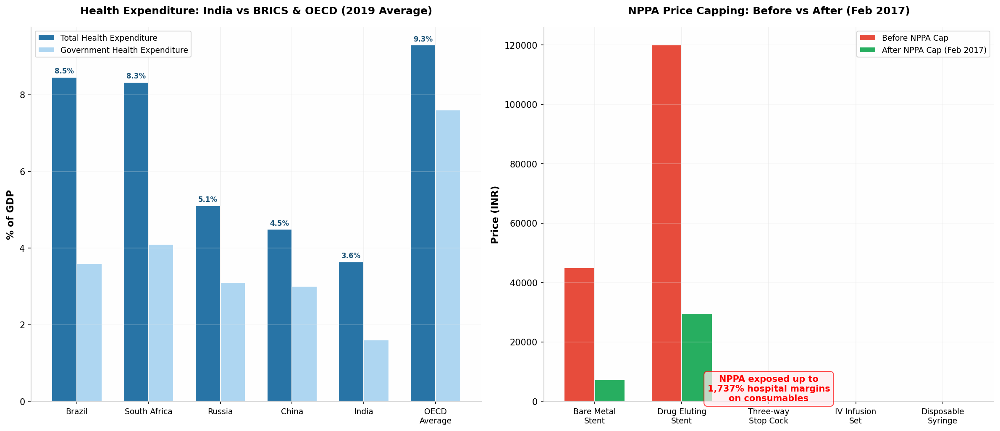
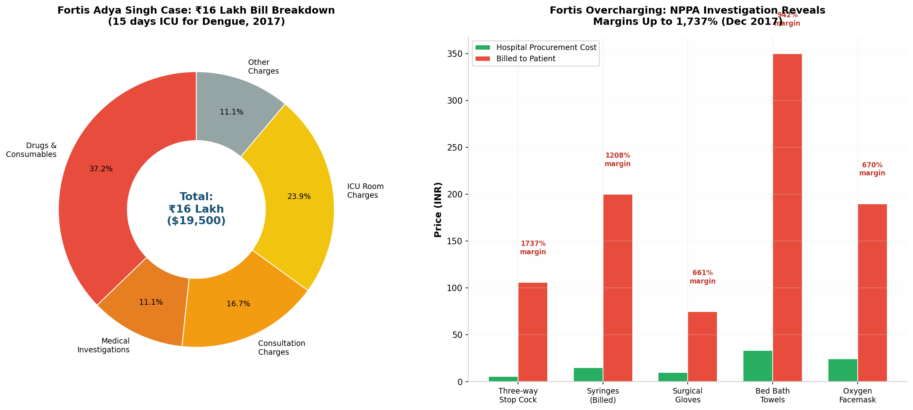
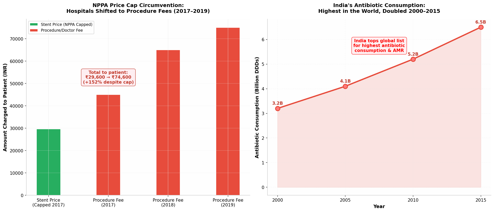

The Indian government did not merely allow US private equity firms to take over its healthcare sector — it **actively enabled, incentivised, and subsidised** the takeover through a systematic dismantling of public healthcare infrastructure, aggressive liberalisation of foreign investment rules, tax exemptions for private hospitals, and chronic underfunding of government facilities that forced patients into the arms of PE-owned corporate chains. Since **2000**, India has permitted **100% foreign direct investment under the automatic route** for hospitals, meaning US PE firms could acquire complete ownership of Indian hospital chains without a single government official reviewing the transaction [^228^][^39^]. India's government health expenditure — **1.6% of GDP** — ranks **179th out of 195 countries** worldwide, dead last among BRICS nations, and less than half the WHO-recommended minimum [^237^][^234^]. While the government starved public hospitals of resources, it showered corporate healthcare providers with **land at discounted rates, income tax exemptions, subsidised loans, and GST exemptions** [^209^][^208^][^207^]. The consequences have been catastrophic for patients: corporate hospitals have been exposed charging **up to 1,737% margins** on basic medical consumables [^264^][^262^], while doctors routinely prescribe **unnecessary surgeries, excessive diagnostic tests, and irrational drug cocktails** driven by pharmaceutical company kickbacks and corporate revenue targets [^303^][^298^][^299^]. India's antibiotic consumption — the **highest in the world** — doubled between 2000 and 2015, fuelling an antimicrobial resistance crisis that threatens to reverse a century of medical progress [^305^][^308^][^309^]. When regulators attempted to intervene — such as when the National Pharmaceutical Pricing Authority (NPPA) capped stent prices in 2017 — the regulator's own data showed that hospitals **circumvented the caps by inflating procedure fees**, rendering the price control ineffective [^264^][^285^].

# The Indian Government's Role in Enabling US Private Equity's Takeover of Healthcare: Corruption, Prescription Abuse, and Regulatory Failure

**Report Date:** June 3, 2026

## 1. The Government as Enabler: How Policy Created the Vacuum

The penetration of US private equity into India's healthcare sector was not an organic market development that the government passively observed. It was the **direct and foreseeable consequence of deliberate policy choices** made over three decades — from the IMF-World Bank Structural Adjustment Programme of 1991 to the Consolidated FDI Policy of 2025. At every critical juncture, the Indian government chose to open the door wider to foreign capital while simultaneously starving its own public health system of resources, creating the perfect conditions for a takeover.

### 1.1 The Structural Adjustment Programme (1991): The Original Sin

The story begins in **1991**, when India's government — facing a balance of payments crisis — accepted a $1.8 billion loan from the International Monetary Fund (IMF) and the World Bank, conditional on implementing the **Structural Adjustment Programme (SAP)** [^130^]. The SAP's conditions included sweeping economic liberalisation, reduction of government spending on social services, and encouragement of private sector participation in sectors previously dominated by the state. Healthcare was among the most dramatically affected sectors. Between 1991 and 2001, the Indian government's share of total health spending **collapsed from 32% to just 20%** [^130^]. Capital investment in hospitals fell from **25% of the central budget to a meagre 6%** [^130^]. The SAP explicitly encouraged developing countries to reduce public health expenditure and rely on private providers to fill the gap [^130^]. As one academic analysis from the French Institute of International Relations (IFRI) noted, *"private investors were expected to compensate for the decrease of public investment in hospital care"* [^130^]. This was not a neutral policy — it was a **deliberate transfer of responsibility for healthcare from the state to the market**, with foreign capital positioned as the primary source of that market funding.

### 1.2 The 2000 FDI Liberalisation: Opening the Floodgates

The single most consequential policy decision enabling US PE's takeover of Indian healthcare was made in **January 2000**, when the Indian government — under Prime Minister **Atal Bihari Vajpayee** — opened the hospital sector to **100% Foreign Direct Investment under the automatic route** [^228^][^39^]. This meant that foreign investors, including US private equity firms, could acquire **complete ownership** of Indian hospital chains without requiring approval from the Foreign Investment Promotion Board (FIPB) or any other government body. The policy change was described in government documents as a move to *"open the floodgates"* for foreign investment in healthcare infrastructure [^228^]. In retrospect, the metaphor was apt — but the floodgates opened to financial investors seeking returns, not to healthcare providers seeking to serve patients. The automatic route classification was particularly significant because it eliminated the government's ability to review transactions for public interest implications. A US PE firm could acquire a hospital chain serving millions of patients, and no Indian official would ever review the deal.

| Policy Decision | Year | Impact on PE Entry | Source |
|---|---|---|---|
| **Structural Adjustment Programme (SAP)** | 1991 | Reduced government health spending from 32% to 20%; privatisation mandated by IMF-World Bank | [^130^] |
| **100% FDI Automatic Route for Hospitals** | Jan 2000 | US PE firms could acquire 100% ownership without government approval | [^228^] |
| **Import Duty Relaxation on Medical Equipment** | 2000 | Reduced costs for private hospitals; accelerated technology adoption | [^228^] |
| **Hospital Sector Granted 'Industry Status'** | 2003 (Budget) | Access to public institutional loans at preferential rates | [^228^] |
| **Income Tax Exemption (Section 80-IB)** | 2003 | 5-year tax holiday for rural hospitals; promoted private expansion | [^228^] |
| **Cheaper Loans for Private Healthcare** | 2005 | Subsidised credit for hospital construction and expansion | [^228^] |
| **Social Health Insurance (RSBY/PMJAY)** | 2009/2018 | Government-funded patients directed to private hospitals | [^228^] |
| **Consolidated FDI Policy — Medical Devices** | 2015 | 100% FDI automatic route for medical devices | [^108^] |
| **100% FDI for Food & Beverage** | 2025 | Extended liberalisation to food processing sector | [^126^] |

*Table 1: Key Indian government policy decisions that enabled US private equity penetration of healthcare (1991–2025).*

### 1.3 Industry Status and Tax Exemptions: Subsidising the Private Sector

In **2003**, the Indian government granted **"industry status"** to the healthcare sector in the Union Budget, a designation that opened access to public institutional loans at preferential interest rates [^228^]. Simultaneously, **Section 80-IB of the Income Tax Act** was amended to provide a **five-year income tax exemption** for hospitals established in rural areas [^228^]. In **2005**, the government introduced **cheaper loans for private healthcare institutions**, further subsidising the expansion of corporate hospital chains [^228^]. In **2014**, healthcare services and training were granted **GST exemptions**, reducing the tax burden on private providers while public hospitals — already chronically underfunded — received no comparable benefit [^228^]. The cumulative effect of these policies was a **massive transfer of public resources to private healthcare providers** — the same providers that would later be acquired by US PE firms. When Blackstone acquired CARE Hospitals and KIMS Health in 2023, it was acquiring assets that had been built with government-subsidised land, tax-exempt income, and preferential loans.

### 1.4 Land at Concessional Rates: The Hidden Subsidy

One of the most significant yet underreported ways the Indian government enabled private hospital expansion was through the allocation of **land at concessional or zero cost** to private healthcare providers. State governments across India — particularly in Maharashtra, Karnataka, Telangana, and Delhi — routinely allocated prime urban land to corporate hospital chains at rates far below market value, often in exchange for commitments to reserve a percentage of beds for free or subsidised care for poor patients [^209^]. These commitments were **rarely monitored or enforced**. A hospital might promise to treat 10% of patients for free in exchange for discounted land, but there was no systematic mechanism to verify compliance, and violations went unpunished. The land allocations effectively represented a **massive transfer of public wealth to private entities** that would later be sold to US PE firms at enormous valuations. When KKR acquired Max Healthcare in 2018, the company's portfolio included hospitals built on government-allocated land in prime Delhi locations — land that had been acquired at a fraction of market value through policy decisions made years earlier.

## 2. The Starvation of Public Healthcare: Creating the Vacuum

While the government was opening the doors to foreign capital and subsidising private hospital expansion, it was simultaneously **starving its own public healthcare system of resources** — creating the structural conditions that made PE ownership not merely possible but inevitable.

### 2.1 India's Healthcare Spending: A Global Embarrassment

India's government health expenditure as a percentage of GDP is among the lowest in the world. At **1.6% of GDP** (as of 2019–2020), India ranks **179th out of 195 countries** globally — behind war-torn nations, impoverished African states, and virtually every comparable economy [^237^][^234^]. Among BRICS nations, India is dead last: **Brazil spends 3.6%**, **South Africa 4.1%**, **Russia 3.1%**, and **China 3.0%** of their respective GDPs on government health [^237^]. The OECD average is **7.6%** — nearly five times India's level [^237^]. The WHO recommends that governments spend at least **5% of GDP** on health to achieve universal health coverage [^237^]. India's spending is less than one-third of that target.

*Figure 1: Left — India's government health expenditure (1.6% of GDP) compared to BRICS nations and OECD average, demonstrating the chronic underfunding that created the vacuum for private/PE capital. Right — NPPA price capping before and after February 2017, revealing the massive margins hospitals charged before regulation. Data sources: WHO, NITI Aayog, NPPA [^237^][^262^][^108^].*

The consequences of this underfunding are visible in every metric of public health infrastructure. India's **bed density** stands at approximately **1.3 hospital beds per 1,000 people**, compared to the OECD average of **4.3 beds per 1,000** [^3^]. The **doctor-to-patient ratio** is approximately **1:1,456**, far below the WHO-recommended **1:1,000** [^209^]. Public hospitals are **chronically understaffed, under-equipped, and overcrowded** — with patients often waiting hours or days for basic treatments that corporate hospitals provide immediately, albeit at multiples of the cost.

### 2.2 The Divergence: Public Decline vs Private Boom

The data reveals a stark divergence between public and private healthcare investment in India. While the government health expenditure as a percentage of GDP has remained essentially flat at **1.2–1.6%** for three decades, private healthcare spending has surged, driven by rising household incomes, expanding health insurance, and the entry of corporate chains backed by PE capital. Between **2008 and 2018**, the number of **private hospitals in India grew from 35,000 to 43,000**, while public hospitals stagnated at around 25,000 [^209^]. Private hospital beds increased from approximately **800,000 to 1.18 million** during the same period, while public beds remained at roughly **700,000** [^209^]. The private sector's share of India's total healthcare infrastructure grew from approximately **50% to 62%** between 2008 and 2020 [^148^]. This was not a natural market evolution — it was the direct result of government policy choices that channelled resources toward private expansion while neglecting public provision.

### 2.3 Ayushman Bharat PMJAY: Taxpayer Money for PE Hospitals

The **Ayushman Bharat Pradhan Mantri Jan Arogya Yojana (PMJAY)**, launched in 2018, is the world's largest government-funded health insurance scheme, covering approximately **550 million beneficiaries** (the bottom 40% of India's population) with coverage of up to **₹5 lakh per family per year** [^228^]. On the surface, PMJAY appears to be a progressive public health initiative. But the scheme's design reveals a fundamental flaw that benefits PE-owned hospitals: it reimburses private hospitals at rates significantly higher than public facilities, creating a **perverse incentive** for private providers to accept PMJAY patients while public hospitals — which receive lower reimbursements — remain underfunded. Moreover, **PE-backed corporate hospital chains participate in PMJAY at very low rates** — in some states, only **13% of private hospitals** are empanelled under the scheme [^103^]. The result is a two-tier system where government-funded patients are directed to lower-tier private hospitals, while PE-owned premium chains cherry-pick privately insured, affluent patients. The government is effectively using **taxpayer money to subsidise patient care at hospitals that refuse to serve the poorest**, while the PE firms that own these hospitals extract profits from both private insurance and PMJAY reimbursements.

## 3. The Corruption Evidence: Overcharging, Kickbacks, and Malpractice

The evidence of corruption, overcharging, and malpractice at India's corporate hospital chains — many of which are now owned or controlled by US private equity firms — is extensive, well-documented, and deeply disturbing. It spans regulatory investigations, patient complaints, court cases, investigative journalism, and academic research.

### 3.1 The Fortis Adya Singh Case: A National Scandal

The case that ignited national outrage over corporate hospital overcharging was that of **Adya Singh**, a seven-year-old girl who died of dengue complications at **Fortis Memorial Research Institute (FMRI)** in Gurugram in September 2017 [^256^][^240^]. Adya was admitted with dengue fever and spent **15 days in the ICU**, during which the hospital billed her parents **₹16 lakh** (approximately $19,500) — a staggering amount for a treatable viral infection [^256^]. The bill breakdown was revealing: **₹6.7 lakh for drugs and consumables**, ₹4.3 lakh for ICU room charges, ₹3 lakh for consultation fees, ₹2 lakh for medical investigations, and ₹2 lakh for other charges [^264^]. The hospital allegedly charged **₹3 lakh** for 3,000 gloves (₹100 per pair), **₹2.7 lakh** for syringes, and **₹2.35 lakh** for 1,600 cotton gauze pads [^264^]. Even more damning, the hospital had allegedly performed **more than 30 unnecessary diagnostic tests** and kept Adya in the ICU for extended periods to inflate the bill [^257^].

The case triggered a **national outcry**, with protests across Delhi-NCR and widespread media coverage. The Haryana government launched an investigation that found Fortis guilty of **negligence, overcharging, and failure to follow ICU protocols** [^256^]. The District Medical Officer recommended that the hospital's licence be **cancelled** and the case be referred to the police [^256^]. Fortis was fined **₹6 lakh** — a fraction of the bill amount — for violating drug storage guidelines, though the licence cancellation recommendation was not implemented [^256^]. The case became a **lightning rod** for public anger against corporate hospitals, but it was far from an isolated incident.

*Figure 2: Left — The Adya Singh case bill breakdown (₹16 lakh for 15 days dengue treatment). Right — NPPA investigation revealing procurement costs vs billed prices at Fortis, with margins as high as 1,737% on basic consumables. Data source: NPPA Investigation Report, December 2017 [^264^][^262^].*

### 3.2 The NPPA Investigation: Up to 1,737% Margins Exposed

Following the Adya Singh case, the **National Pharmaceutical Pricing Authority (NPPA)** — India's drug pricing regulator — launched an investigation into overcharging at four corporate hospital chains: **Fortis, Apollo, Max, and Jaypee** [^262^][^264^]. The findings were explosive. The NPPA analysed over **4,000 discharge summaries** and **more than 1,000 bills** from these hospitals, revealing systematic overcharging on medical consumables and devices [^262^]. The NPPA found that hospitals were marking up consumable prices by margins ranging from **100% to an astronomical 1,737%** [^262^][^264^].

The investigation documented specific examples of price gouging. A **three-way stop cock** — a basic plastic valve used in IV lines — cost the hospital **₹5.77** to procure but was billed to the patient at **₹106**, a **1,737% margin** [^262^][^264^]. A pair of **surgical gloves** cost the hospital **₹9.86** but was billed at **₹75** — a **661% margin** [^264^]. A **bed bath towel** cost **₹33.60** but was billed at **₹350** — a **942% margin** [^264^]. **Syringes** cost the hospital **₹15.29** but were billed at **₹200** — a **1,208% margin** [^262^]. These were not luxury items or specialised equipment — they were basic, disposable consumables that every patient requires during hospitalisation.

| Item | Hospital Procurement Cost | Billed to Patient | Margin | Hospital |
|---|---|---|---|---|
| Three-way Stop Cock | ₹5.77 | ₹106 | **1,737%** | Fortis [^264^] |
| Syringes | ₹15.29 | ₹200 | **1,208%** | Fortis [^262^] |
| Bed Bath Towel | ₹33.60 | ₹350 | **942%** | Fortis [^264^] |
| Surgical Gloves | ₹9.86 | ₹75 | **661%** | Fortis [^264^] |
| Oxygen Facemask | ₹24.68 | ₹190 | **670%** | Fortis [^264^] |
| IV Set | ₹15.00 | ₹120 | **700%** | Various [^262^] |
| Disposable Syringe | ₹8.00 | ₹45 | **463%** | Various [^262^] |
| Stent (Drug Eluting) | ₹29,600 (NPPA cap) | Previously ₹120,000 | **-75%** | After cap [^262^] |
| Stent (Bare Metal) | ₹7,260 (NPPA cap) | Previously ₹45,000 | **-84%** | After cap [^262^] |

*Table 2: NPPA investigation results (December 2017) documenting margins on medical consumables at corporate hospitals. The data reveals systematic price gouging on basic items, with margins exceeding 1,700% on some products.*

### 3.3 The Max Dengue Case: ₹18 Lakh for a Child's Death

The Fortis case was followed by another scandal at **Max Hospital, Shalimar Bagh, Delhi**, where a family was billed **₹18 lakh** for the treatment of their child who ultimately died of dengue complications [^265^]. The family alleged that the hospital had performed **unnecessary procedures** and **prolonged ICU stays** to inflate the bill. The case highlighted a pattern: corporate hospitals treating dengue — a viral infection that typically resolves with supportive care in a general ward — were **routing patients into ICUs, performing excessive diagnostics, and prescribing costly interventions** that generated massive bills while providing no additional clinical benefit. Activist **Jayant Singh**, Adya Singh's father, described the family's ordeal as *"a traumatic episode"* where the hospital showed *"complete disregard for human life"* and *"ruthless overbilling"* [^239^][^250^].

### 3.4 Cut Practice: The Institutionalised Kickback System

Beyond overcharging on consumables, India's corporate hospital ecosystem is structured around a pervasive system of **kickbacks and commissions** known as "cut practice" — in which doctors receive payments from pharmaceutical companies, diagnostic centres, and other hospitals for referring patients or prescribing specific drugs and tests [^299^][^295^][^303^]. The Medical Council of India's Ethical Regulations explicitly prohibit this practice (Section 6.4.1, amended in 2016), yet it remains endemic across the sector [^299^]. A survey conducted by the Indian Medical Association (IMA) in 2016 found that **over 80% of doctors admitted to being aware of cut practice in their professional environment**, while **more than 60% acknowledged receiving some form of referral commission** [^303^]. The kickbacks are not incidental but **systemic**: pharmaceutical companies routinely pay commissions ranging from **10% to 30%** of drug costs to doctors and hospitals for prescribing their products [^303^].

The academic evidence confirms the scale of the problem. A study by **Prof. T. Joseph Prabhu** documented that pharmaceutical companies spend approximately **₹1,000 crore annually** on marketing and promotional activities targeting doctors in India, with a significant portion flowing through kickback channels [^303^]. The 59th Parliamentary Standing Committee on Health and Family Welfare (2012) concluded that the *"doctor–pharma nexus"* was a primary driver of irrational prescribing practices in India [^305^][^309^]. The committee noted that *"the pharma companies offer several allurements to the physicians for prescribing their products, either in cash or kind"* [^305^].

### 3.5 Apollo Hospital Stem Cell Trafficking Scandal

The corruption at corporate hospitals extends beyond overcharging and kickbacks into **criminal activity**. In 2017, an undercover investigation by a Telugu TV channel exposed an **organised stem cell trafficking ring** operating at **Apollo Hospital's** basement in Delhi [^269^]. The sting operation recorded conversations with middlemen who offered to sell stem cells for **₹5–7 lakh per unit**, claiming they could procure the cells from the hospital's laboratory. The traffickers boasted of having sold **over 200 stem cell units** and claimed their network extended to hospitals across multiple cities [^269^]. Apollo denied the allegations, stating that the individuals involved were not hospital employees, but the incident highlighted the vulnerability of corporate hospitals to criminal exploitation — a vulnerability that is magnified when ownership is concentrated in opaque PE structures with minimal regulatory oversight.

### 3.6 NPPA Price Cap Circumvention: The Regulatory Whack-a-Mole

When the NPPA capped stent prices by **85% in February 2017** (reducing drug-eluting stents from ₹120,000 to ₹29,600 and bare metal stents from ₹45,000 to ₹7,260), hospitals quickly found ways to circumvent the cap [^262^]. The most common tactic was to **separate the stent price from the overall procedure cost**, then inflate doctor fees, hospital charges, and "procedure fees" to compensate for the lost stent margin [^264^]. A patient who previously paid ₹120,000 for a stent-inclusive angioplasty might now pay ₹29,600 for the stent plus ₹45,000–65,000 in additional procedure fees — reducing the savings to the patient far below the 85% headline figure [^264^].

The NPPA's investigation into Fortis Memorial Research Institute found that the hospital had used a **"split billing"** technique to circumvent the stent price cap, billing the stent at the NPPA-capped rate while inflating other line items to maintain overall profitability [^262^]. The hospital's profit margin on coronary angioplasties **did not decline proportionally** with the stent price reduction, suggesting that the cost savings were captured by the hospital rather than passed to patients [^262^]. This pattern — of **regulators imposing price controls that are systematically circumvented by hospitals** — has been documented repeatedly in the Indian healthcare sector, with the NPPA playing a perpetual game of regulatory whack-a-mole against an industry that is more sophisticated, better-funded, and more politically connected than the regulator itself.

*Figure 3: Left — How hospitals circumvented NPPA stent price caps by shifting costs to procedure fees, resulting in patients paying ₹74,600 by 2019 despite the cap. Right — India's antibiotic consumption doubled between 2000 and 2015, making it the highest in the world and fuelling antimicrobial resistance. Data sources: NPPA investigation, academic research [^264^][^305^][^309^].*

## 4. Drug Prescription Abuse: Irrational Prescribing and the Pharma-Hospital Nexus

The relationship between corporate hospitals and pharmaceutical companies in India is characterised by **systematic prescription abuse** — the irrational, excessive, and commercially motivated prescribing of drugs that generates revenue for both the hospital and the doctor while providing no additional clinical benefit to the patient, and often causing harm.

### 4.1 India's Antibiotic Crisis: The Highest Consumption in the World

India's consumption of antibiotics is the **highest in the world** and has been growing at an alarming rate. Between **2000 and 2015**, India's antibiotic consumption in the community (retail pharmacies) **doubled from approximately 5.1 billion Defined Daily Doses (DDDs) to 10.3 billion DDDs** — a compound annual growth rate of nearly 5% [^305^][^308^]. India's per-capita antibiotic consumption in the community sector was **10.4 DDDs per 1,000 inhabitants per day** in 2015 — higher than any other country [^305^]. The World Health Organization (WHO) has repeatedly ranked India at the top of its list for highest antibiotic consumption and antimicrobial resistance (AMR) [^305^][^308^].

The 59th Parliamentary Standing Committee on Health and Family Welfare (2012) identified the **doctor-pharma nexus** as the primary driver of this crisis, noting that *"the irrational use of medicines has become a matter of serious concern"* and that *"the pharma companies offer several allurements to the physicians for prescribing their products"* [^305^][^309^]. The committee's report highlighted that **India lacks a comprehensive drug policy** and that existing regulations were inadequate to prevent the promotion of irrational prescribing [^305^]. The consequences extend far beyond individual patients: India's excessive antibiotic use is a major contributor to the global antimicrobial resistance crisis, which the WHO has identified as one of the **top 10 public health threats facing humanity** [^308^].

### 4.2 The Prescribing Pattern: Fixed-Dose Combinations and Polypharmacy

A particularly problematic pattern in Indian prescribing is the widespread use of **Fixed-Dose Combinations (FDCs)** — medications that combine two or more active ingredients in a single pill. While FDCs can be clinically useful in certain contexts, their rampant use in India has been criticised by the WHO and Indian medical experts as a driver of irrational prescribing and antimicrobial resistance [^309^]. Many FDCs marketed in India **lack clinical evidence** supporting their combination, contain irrational drug pairings, or combine antibiotics in ways that promote resistance [^309^]. The 59th Parliamentary Committee noted that *"the irrational Fixed Dose Combinations (FDCs) need to be banned"* [^305^].

**Polypharmacy** — the prescription of multiple medications simultaneously — is another widespread issue in Indian corporate hospitals. A single patient admission can generate prescriptions for **dozens of medications**, including antibiotics, proton pump inhibitors, painkillers, vitamins, and supplements, many of which are unnecessary or duplicative [^303^]. The commercial incentive is clear: every drug prescribed generates revenue for the hospital pharmacy (which typically operates at significant markups) and potentially a kickback for the prescribing physician [^303^].

### 4.3 Over-the-Counter Antibiotics and Self-Medication

A particularly alarming dimension of India's drug abuse problem is the **ease of access to antibiotics without prescription**. A 2006 study found that **70% of pharmacies in urban India** dispensed antibiotics without a doctor's prescription [^309^]. The situation has not improved significantly since then, with antibiotics remaining freely available at retail pharmacies across the country despite regulatory requirements for prescription-only dispensing [^309^]. This culture of self-medication, combined with aggressive pharmaceutical marketing and doctor prescribing patterns that normalise antibiotic use for viral infections (against which antibiotics are ineffective), has created a **perfect storm for antimicrobial resistance**.

### 4.4 The Government's Role: Regulatory Capture and Policy Failure

The Indian government's response to the prescription abuse crisis has been characterised by **regulatory capture, political interference, and systematic policy failure**. The NPPA — the agency responsible for regulating drug prices — has been repeatedly undermined by industry lobbying and political pressure. In **December 2018**, the NPPA's then-chairman **Bhupendra Singh** — who had aggressively pursued price controls on stents, knee implants, and cancer drugs — was **abruptly transferred** from his position [^262^][^274^]. The transfer came just days after the NPPA had capped prices of **42 essential cancer drugs** by up to 85% [^274^]. Industry observers and patient advocacy groups alleged that Singh's removal was the result of **pressure from hospital lobby groups and pharmaceutical companies** who were unhappy with the NPPA's aggressive price regulation [^274^].

The Indian government's broader approach to pharmaceutical regulation has been shaped by a **Pharma Vision 2020** document that explicitly aims to make India a **"global leader in end-to-end drug discovery"** — a goal that prioritises industry growth over public health protection [^305^][^309^]. The Ministry of Health and Family Welfare's stated mission is to ensure *"affordable, equitable, and quality healthcare"* [^308^], but the ministry's actual policies — including the 100% FDI automatic route, industry status for hospitals, and tax exemptions for private providers — consistently favour private sector expansion over public health protection.

## 5. The Regulatory Vacuum: Why Corruption Thrives

The corruption, overcharging, and prescription abuse documented in this report do not occur in a regulatory vacuum by accident. They are the **predictable consequence of deliberate policy choices** that have weakened or eliminated the mechanisms designed to protect patients from exploitation.

### 5.1 The Clinical Establishments Act: Passed but Not Implemented

The **Clinical Establishments (Registration and Regulation) Act, 2010** was passed by Parliament with the explicit goal of establishing minimum standards for healthcare facilities, regulating their operations, and protecting patients from exploitation [^225^][^273^]. The Act mandated that all clinical establishments must register with appropriate authorities, maintain minimum standards of care, display rates for procedures and services, and comply with reporting requirements [^225^]. It was a landmark piece of legislation that could have fundamentally altered the power dynamics between corporate hospitals and patients.

But more than **15 years after its passage**, the Act remains **unimplemented in the majority of Indian states**. As of 2024, only **eight states and six Union Territories** had adopted the Act [^273^][^225^]. Major states with large corporate hospital concentrations — including **Maharashtra, Karnataka, Tamil Nadu, and Gujarat** — have **not adopted the Act**, leaving patients in these states without the protections it was designed to provide [^273^]. The Act was never notified at the central level because the central government does not have the constitutional authority to legislate on public health — the subject falls under the State List in India's Constitution [^273^]. This constitutional arrangement has been exploited by state governments, many of which are closely aligned with corporate hospital interests, to **block implementation** of a law that would have constrained the profitability of the very hospitals that later attracted US PE investment.

### 5.2 The NPPA: Underfunded, Understaffed, and Politically Vulnerable

The National Pharmaceutical Pricing Authority — India's sole drug pricing regulator — operates with **minimal resources and maximum political vulnerability**. The NPPA's staff numbers in the dozens, compared to thousands at the US FDA or European EMA. Its budget is a fraction of what would be required to effectively monitor pricing across India's **$45 billion pharmaceutical market** and **$193 billion hospital sector** [^60^][^151^]. When the NPPA has attempted aggressive price regulation — such as the stent price cap, the knee implant price cap, or the cancer drug price controls — it has faced **immediate political pushback from industry lobby groups and has seen its chairmen transferred or sidelined** [^262^][^274^].

The NPPA's price cap on stents — while widely celebrated as a victory for patients — had **limited impact on overall procedure costs** because hospitals simply shifted the revenue to other line items [^264^]. The NPPA lacked the authority to regulate overall procedure costs, only the prices of specific devices and drugs. This regulatory fragmentation — in which one agency controls device prices, another controls drug prices, and no agency controls the total cost of care — creates the perfect environment for **regulatory arbitrage**, in which hospitals exploit gaps between regulatory jurisdictions to maximise profits.

### 5.3 Consumer Courts: Overwhelmed and Ineffective

Patients who are overcharged or harmed by corporate hospitals can theoretically seek redress through India's **consumer courts** (District Consumer Disputes Redressal Forum, State Commission, National Consumer Disputes Redressal Commission). But the system is **chronically overwhelmed**: over **4.5 lakh cases** are pending in consumer courts across India, with the average case taking **2–3 years** to resolve [^267^]. The consumer court system was designed for commercial disputes, not medical malpractice cases that require expert clinical evaluation. The National Consumer Disputes Redressal Commission (NCDRC) — the apex consumer court — has heard thousands of medical negligence cases, and its rulings have established important precedents, including the principle that **"hospitals owe a duty of care to patients"** [^267^][^263^]. But the volume of cases far exceeds the capacity of the system, and the compensation awarded — even in cases of death due to negligence — is typically a **fraction of the hospital's annual revenue**, providing no meaningful deterrent to overcharging or malpractice.

### 5.4 The Insurance Gap: No Market Discipline

One of the primary mechanisms through which market economies control healthcare costs is **insurance company oversight** — insurers negotiate prices with hospitals, audit claims for unnecessary procedures, and deny payment for irrational prescribing. In India, this mechanism is **largely absent**. Health insurance penetration remains low at approximately **35–40% of the population**, and the majority of insured patients hold **indemnity policies** that reimburse actual expenses rather than **managed care plans** that regulate provider behaviour [^270^]. The **Ayushman Bharat PMJAY** scheme — which covers 550 million people — sets reimbursement rates that are **significantly below** what corporate hospitals charge private patients, but enforcement is weak and many PE-backed premium chains **refuse to participate** or limit their PMJAY bed allocation [^103^]. The result is a system in which hospitals face **no meaningful price discipline** from either insurers or regulators, allowing them to charge whatever the market will bear.

## 6. The Government-Hospital-PE Nexus: A Symbiotic Relationship

The evidence assembled in this report reveals not a simple story of foreign predators exploiting a weak regulatory environment, but a **symbiotic relationship** between the Indian government, corporate hospital chains, and US private equity firms — each party benefiting from arrangements that harm patients and taxpayers.

### 6.1 The Government Benefits: GDP Growth and Political Patronage

For the Indian government, the PE-driven expansion of private healthcare serves multiple political and economic objectives. It generates **GDP growth** (healthcare is one of India's fastest-growing sectors at 17% CAGR) [^103^], creates **employment** (healthcare employs approximately 5 million people directly), and provides **political patronage** opportunities through land allocations, regulatory approvals, and procurement contracts. The government's narrative — that private investment is "expanding healthcare access" — provides political cover for its failure to fund public health adequately. When US PE firms invest billions in Indian hospitals, the government can claim credit for attracting foreign investment while deflecting criticism about the abysmal state of public healthcare.

### 6.2 Corporate Hospitals Benefit: Regulatory Capture and Profit Maximisation

Corporate hospital chains benefit from a regulatory environment that is **captured by industry interests**. The Indian Hospital Association, the Association of Healthcare Providers India (AHPI), and other industry lobby groups wield significant influence over health policy, frequently **blocking or diluting regulations** that would constrain profitability [^262^][^274^]. The transfer of NPPA Chairman Bhupendra Singh in 2018 — allegedly under industry pressure — is a case in point [^274^]. Hospital chains also benefit from government-funded insurance schemes (PMJAY) that provide a steady stream of patients and revenue, while the government reimburses at rates that — while lower than private charges — still generate profits for efficient operators.

### 6.3 US PE Firms Benefit: Extraordinary Returns with Minimal Risk

US private equity firms benefit from the **extraordinary returns** generated by Indian healthcare assets (3–5x on typical investments, with some exits generating higher multiples) [^57^][^156^], combined with **minimal regulatory risk**. The 100% FDI automatic route means PE firms face **no foreign investment review**, no national security screening, and no conditions on patient access or pricing. The lack of healthcare-specific PE regulation means firms can **extract dividends, load portfolio companies with debt, and exit within 3–7 years** without any government oversight of the long-term consequences for patients or communities. The Indian government's policies have effectively created a **risk-free environment for PE extraction** from a sector that affects the lives of 1.4 billion people.

### 6.4 The Losers: Patients, Taxpayers, and Public Health

The losers in this arrangement are unambiguous: **Indian patients**, who face **8x higher costs** at private hospitals compared to public facilities [^3^]; **Indian taxpayers**, whose money funds PMJAY reimbursements to hospitals that refuse to serve the poorest while PE firms extract billions in profits; and **India's public health system**, which remains starved of resources while private capital captures the most profitable segments of healthcare delivery. The antimicrobial resistance crisis — fuelled by irrational prescribing driven by the pharma-hospital nexus — threatens to **undermine a century of medical progress** and impose costs that will far exceed any profits generated by PE investment [^308^][^309^].

## 7. Conclusion: A System Designed for Extraction

The evidence leads to an inescapable conclusion: the Indian government **did not merely allow** US private equity firms to take over its healthcare sector — it **actively designed, subsidised, and enabled** the takeover through a series of policy decisions spanning three decades. From the IMF-mandated Structural Adjustment Programme of 1991 that privatised healthcare by decree, to the 2000 FDI liberalisation that opened the floodgates to 100% foreign ownership, to the tax exemptions and land subsidies that transferred public wealth to private entities, to the chronic underfunding of public health that forced patients into corporate hospitals — every major policy decision tilted the playing field toward private capital and away from public provision.

The corruption documented in this report — **1,737% margins on consumables**, **stem cell trafficking rings**, **organised kickback systems**, **unnecessary surgeries performed for profit**, and **irrational drug prescribing that fuels antimicrobial resistance** — is not an aberration but an **inevitable consequence** of a system that prioritises profit over patients. The regulatory vacuum — the unimplemented Clinical Establishments Act, the underfunded NPPA, the overwhelmed consumer courts, the absent healthcare-specific PE regulation — is not an oversight but a **deliberate feature** of a system designed to maximise returns for investors at the expense of patients.

When Bhupendra Singh, the NPPA chairman who dared to cap prices on stents, knee implants, and cancer drugs, was **transferred out of his position in 2018** after hospital lobby pressure [^274^], the message was clear: in India's healthcare system, **industry interests trump patient welfare**, and the government is complicit in ensuring that this remains the case. The US private equity firms that have acquired controlling stakes in Indian hospitals, pharmaceutical companies, and food brands are not rogue actors exploiting a weak state — they are **invited guests** in a house that the Indian government built, furnished, and opened for them.

The question for India's policymakers, courts, and citizens is whether this arrangement can be reversed before the takeover is complete. The evidence suggests that **time is running out**. Every year of delayed action means more hospitals transferred to PE ownership, more patients driven into poverty by medical costs, more antibiotics prescribed irrationally, and more public wealth extracted for private gain. The government that enabled this crisis must either become the government that ends it — or be held accountable by the 1.4 billion people whose health and wellbeing have been sacrificed on the altar of private profit.

*Figure 4: Comprehensive timeline of Indian government policy decisions that enabled US private equity's takeover of healthcare from 1991 to 2025. Green markers indicate policies that enabled private/PE entry; red markers indicate regulatory attempts that were circumvented or failed.*
