# Ownership and Control Map

This map distinguishes legal ownership, economic exposure, and operational influence. It does not infer control where only a minority non-controlling stake is documented.

## Healthcare and Pharmaceuticals

### Aster DM Quality Care / QCIL / CARE / KIMS

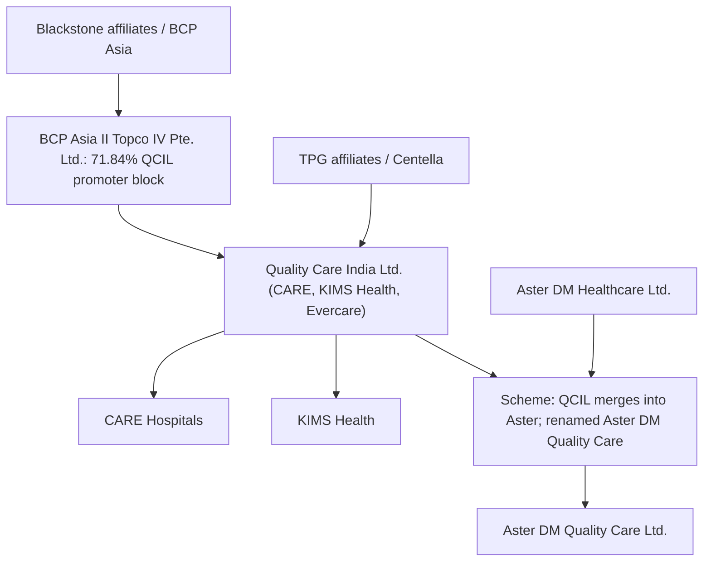

Evidence: S10 verifies the CCI-approved transaction parties and QCIL network. S119 verifies, through a scanned Aster-hosted QCIL shareholding pattern, that BCP Asia II Topco IV Pte. Ltd. held the 71.84% promoter/promoter-group block in QCIL. S11 states the announced post-merger shareholding: Aster shareholders 57.3%, QCIL shareholders 42.7%, with Aster promoters 24.0% and Blackstone 30.7%. S12 and S57 state that completion was expected in Q1 FY27. S118 adds the April 2, 2026 stock-exchange intimation and March 23 NCLT-order text: the joint company petition was fixed for hearing on May 22, 2026, after statutory notices and publication.

Control assessment: VERIFIED FACT that Blackstone and TPG affiliates were key QCIL owners and that Blackstone would be the largest named institutional shareholder in the proposed combined listed hospital group. Treat legal completion as pending until final NCLT sanction/effective-date and post-merger shareholding filings are verified.

### Manipal Health Enterprises

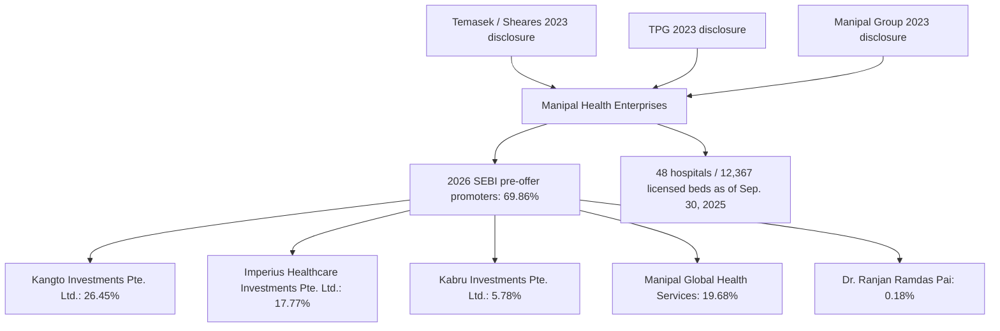

Evidence: S21 and S117.

Control assessment: VERIFIED FACT that Temasek-linked entities became the dominant foreign shareholder group after the 2023 transaction and that the 2026 SEBI abridged prospectus verifies the pre-offer promoter holdings and operating network. The abridged prospectus identifies Mauritius and Singapore holding companies, but full board/control rights still require the complete DRHP, shareholder agreements, and post-offer filings.

### HCG Oncology

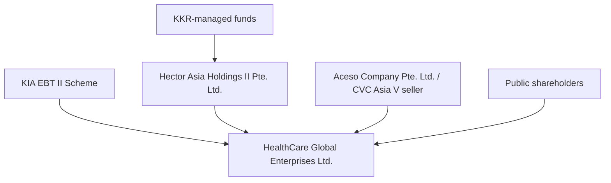

Evidence: S13 and S14 state that Hector and EBT would acquire up to 54% from Aceso/CVC in two tranches, triggering an open offer up to 26%, with expected final stake between 54% and 77%.

Control assessment: VERIFIED FACT that KKR was expected to become the controlling shareholder if the acquisition and open offer completed as announced.

### Healthium MedTech

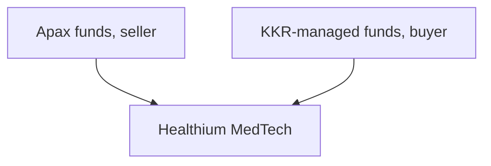

Evidence: S22.

Control assessment: VERIFIED FACT for transfer of controlling interest; official deal value was undisclosed.

### Baby Memorial Hospital

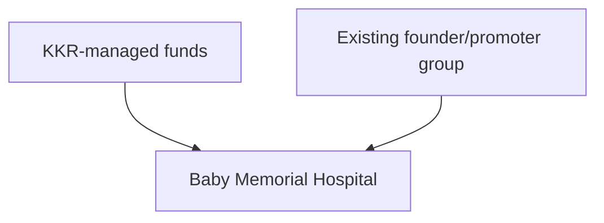

Evidence: S24.

Control assessment: STRONG EVIDENCE-BASED CONCLUSION for KKR controlling stake. Exact percentage and value require primary deal filings; press reports cite around 70% and around INR 2,000 crore, but those are not treated as verified facts here.

### Early Hospital PE Reference Points

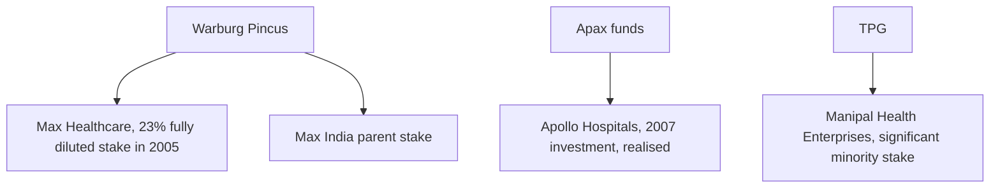

Evidence: S32, S33, S34.

Control assessment: VERIFIED FACT for early foreign PE/institutional investment exposure. These sources support the historical entry timeline but do not provide full board-control or shareholder-agreement terms.

### Thyrocare / API Holdings / PharmEasy

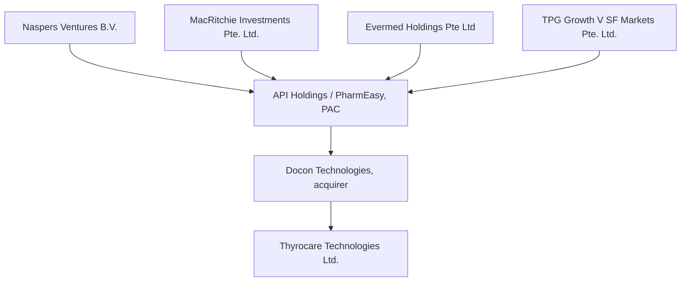

Evidence: S35.

Control assessment: VERIFIED FACT that Docon/API agreed to acquire 66.11% of Thyrocare and triggered a 26% open offer. The SEBI filing also verifies meaningful foreign institutional exposure in API Holdings. It does not prove that any single foreign investor controlled API.

### Diagnostics and TPA Reference Map

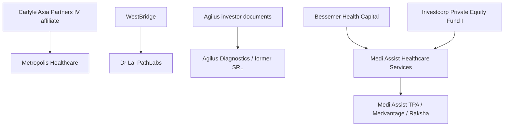

Evidence: S44, S45, S46, S48.

Control assessment: VERIFIED FACT for Carlyle-Metropolis, WestBridge-Dr Lal, and Bessemer/Investcorp exposure in Medi Assist. Medi Assist's March 2026 BSE pattern now shows a 4.61% promoter/group stake, 95.39% public stake, large institutional ownership and Bessemer-linked reclassification notes [S112]. Agilus is partly clarified by CCI/PIB evidence showing approved Fortis consolidation from 57.68% to 89.2% post combination, while closing evidence, named sellers and residual minority holders remain filing-level gaps [S111].

### Health Insurance Reference Map

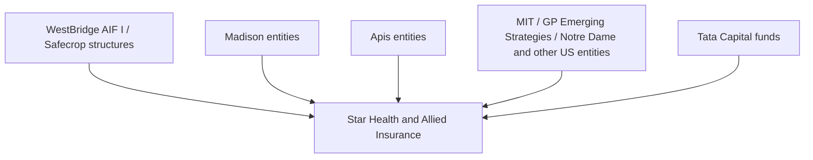

Evidence: S47.

Control assessment: VERIFIED FACT that Star Health DRHP documents multiple investor transactions and IRDAI approvals. The control position is complex and should not be reduced to a single foreign-control claim without post-listing shareholding and governance-right analysis.

### Piramal Pharma

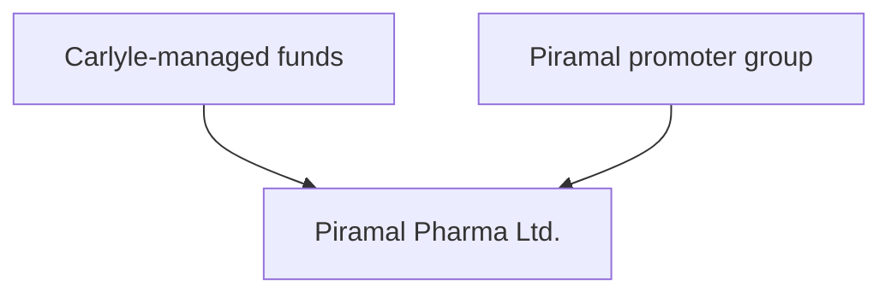

Evidence: S20.

Control assessment: VERIFIED FACT for 20% minority strategic-growth investment. This is influence exposure, not control.

### Bharat Serums and Vaccines

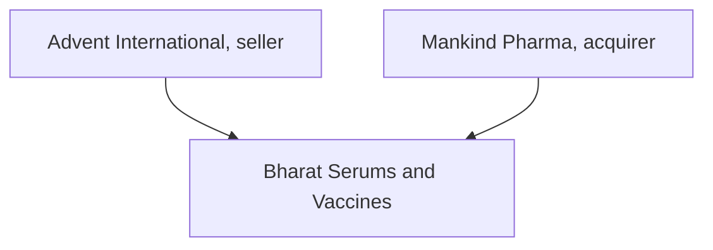

Evidence: S23.

Control assessment: VERIFIED FACT that Advent exited and Mankind acquired 100%.

### JB Chemicals and Pharmaceuticals

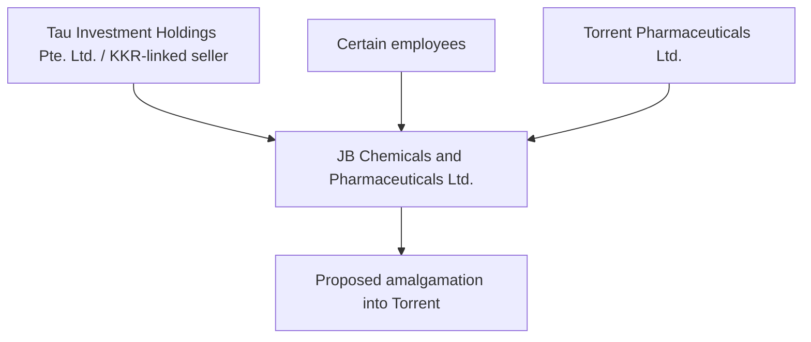

Evidence: S15 and S16.

Control assessment: VERIFIED FACT that Torrent agreed to buy 46.39% from Tau, 2.41% from employees, launch a 26% open offer, and then pursue merger. CCI approved subject to remedies.

## Food and Agriculture

### Haldiram Snacks Food

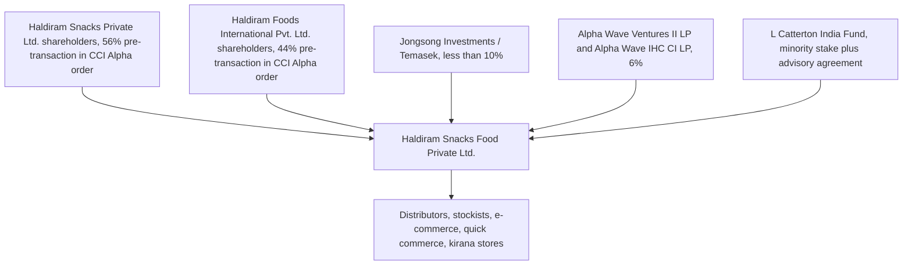

Evidence: S17, S18, S19.

Control assessment: VERIFIED FACT for multiple minority institutional investors. UNPROVEN CLAIM that Haldiram is foreign-controlled. CCI orders identify minority stakes and no AAEC findings; the advisory agreement in S19 is a governance influence channel but not proven control.

### Capital Foods

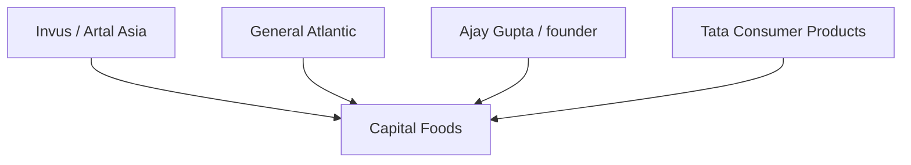

Evidence: S25.

Control assessment: VERIFIED FACT that Tata Consumer signed to acquire 100% in phases, 75% upfront and 25% over three years. This is a PE-backed exit to a domestic strategic buyer, not foreign control after acquisition.

### Balaji Wafers

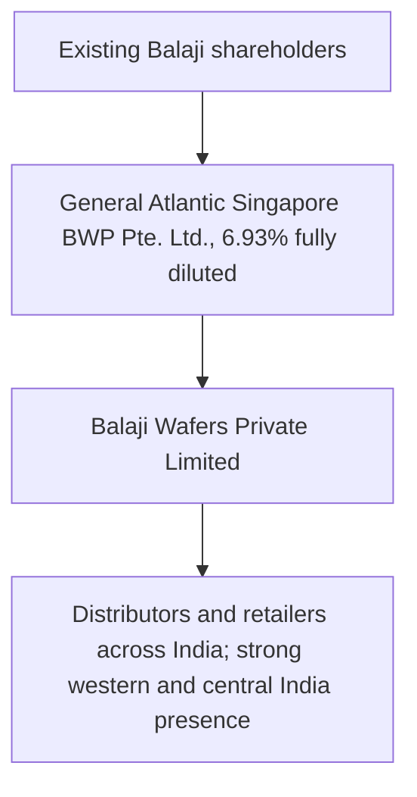

Evidence: S70, S71, S135.

Control assessment: VERIFIED FACT for minority foreign institutional/growth-capital exposure. The CCI order verifies 6.93% fully diluted shareholding and a shareholders agreement, but reviewed public text does not establish foreign control. Economic Times valuation figures are press-supported, not official.

### Theobroma Foods

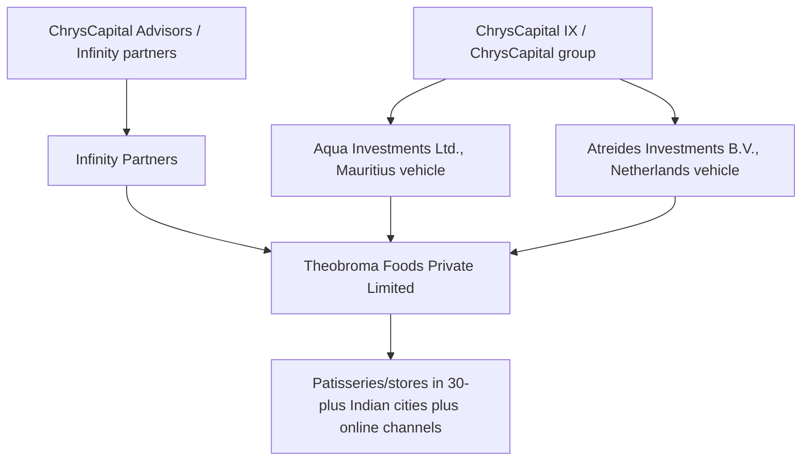

Evidence: S72.

Control assessment: VERIFIED FACT that CCI approved a ChrysCapital-related proposed secondary acquisition of approximately 84% of Theobroma shareholding and voting rights on a fully diluted basis. Closing confirmation and private governance terms remain to be reviewed.

### Food Delivery, Quick Commerce, and Grocery Platforms

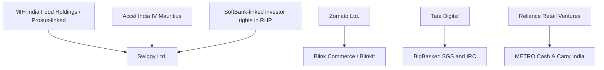

Evidence: S36, S37, S38, S39, S40, S41, S107.

Control assessment: VERIFIED FACT for large platform transactions and foreign institutional exposure in Swiggy. Official BSE March 2026 data verify Swiggy had no promoter holding, public shareholders at 94.41%, employee stock option trust at 5.59%, foreign-ownership utilization of 52.19%, MIH India Food Holdings BV at 21.06%, SVF II Songbird at 6.26%, Accel India IV Mauritius at 2.77%, Tencent Cloud Europe at 1.97%, Elevation Capital V at 1.35% and Norwest Venture Partners VII-A Mauritius at 1.33% [S107]. Zomato-Blinkit, Tata-BigBasket, and Reliance-METRO are primarily domestic strategic consolidation cases. They are relevant to food-system market structure, demand aggregation, and bargaining power, but they are not evidence that foreign PE controls food distribution after the transactions.

### Advanta Enterprises

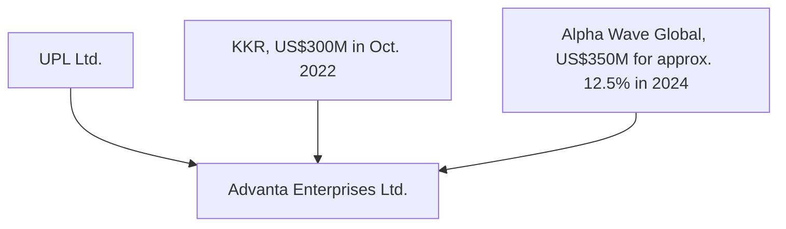

Evidence: S26.

Control assessment: VERIFIED FACT for Alpha Wave's approx. 12.5% investment and UPL disclosure of prior KKR investment. Downstream farmer impact remains unproven without seed pricing, licensing, and procurement data.
